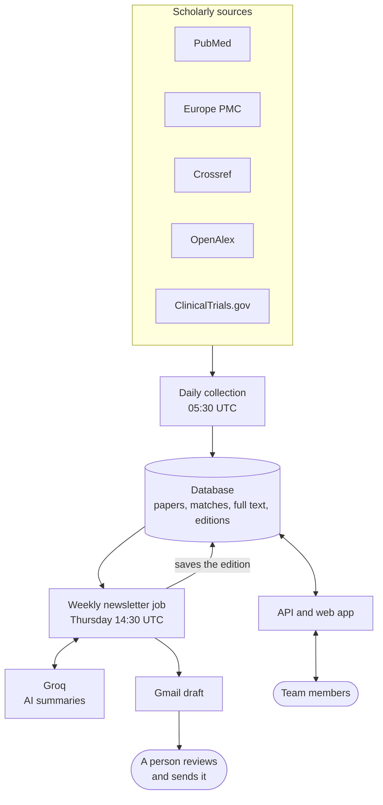
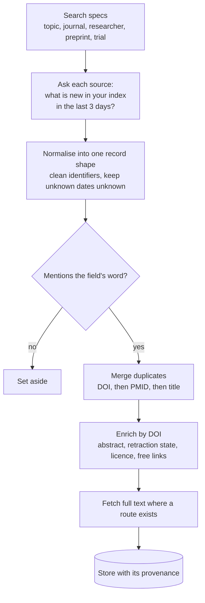

# Migraine Research Monitor

> A scheduled ingestion pipeline, a PostgreSQL store, a token-protected REST API with a small web app, and a weekly newsletter generator, for keeping up with a research field. Made for a client to help him keep on tabs with focused Migraine Research

Every day the service searches the main scholarly sources, de-duplicates and enriches what it finds, and stores it with the full text where it can get it. Every week it renders a **newsletter into a Gmail draft** for a person to review and send it over to the Client. A **REST API and web app** let the team search the whole collection and tune what goes into the next newsletter.

The first deployment is for **Curt: migraine research** (10 journals, 30 researchers, 12 topics). What counts as relevant lives in YAML config, not in code, so the same service can watch another field.

_Naming note: the Python package and the CLI are still called `research_agent` and `research-agent`, from the project's first design._

> The service **never sends email**. It creates a draft; a person reads it and presses send.

## At a glance

| Service | Trigger | What it does |
|---|---|---|
| `daily-collect` | cron, 05:30 UTC | search the sources, merge, match, enrich, store |
| `weekly-newsletter` | cron, Thursday 14:30 UTC (20:00 IST) | fetch full text, select, summarise, render, create the Gmail draft; the edition is dated Friday |
| `api` | always on | REST API under `/v1` and the web app at `/app` |

| Stack | |
|---|---|
| Language | Python 3.12 |
| API | FastAPI, uvicorn, pydantic v2 |
| Data | PostgreSQL (Supabase) in production, SQLite for local work; SQLAlchemy 2 and Alembic migrations |
| Ingestion | httpx client with per-host pacing, retries and back-off; one thread per source |
| Rendering | Jinja2: HTML tuned for Gmail's compose window, plus plain text |
| Summaries | any OpenAI-compatible endpoint (Groq); used for summaries only |
| Hosting | Docker image on Railway (one API service and two cron jobs), database on Supabase |
| Quality | pytest, 536 offline tests against recorded API responses; GitHub Actions runs them |

## What it looks like

**The weekly newsletter** (HTML for Gmail, plus a plain-text version): where the papers came from, then the papers grouped by topic, each with a short checked summary.


**The web app, Search tab:** chip filters over sources, journals, researchers and topics, all backed by `GET /v1/papers`.


**The web app, Editions tab:** every built newsletter, with a formatted preview, a phone-width view and the plain text.


_The screenshots use test data._

## How it works



Two scheduled jobs and one API service share a database and never call each other. The **daily job** fills it, the **weekly job** reads it to build a newsletter, and the **API** serves both, with a read-only connection for data and a separate switches-only connection for the newsletter settings.

**Selection rules, in plain English**

* A paper goes into an edition by the date **our database first stored it**, not its publication date.
* **Never twice:** a paper appears in at most one edition (a database constraint enforces it).
* **Recent only:** papers published more than 7 days before we found them are left out.
* **Retractions come first**, in their own section.
* **Size is capped.** Papers held back by a cap may return in the **next** edition only, ranked a little lower. Papers from monitored journals and researchers are chosen first.
* **Summaries are validated.** The model sees only the title and abstract, and every number in its summary must appear in the abstract; otherwise a plain extract is used.
* The edition is **dated Friday** even though it is built on Thursday evening; its content is everything stored up to the build.

## Data sources and ingestion

No single index is complete: in a measured window each of the five sources found only **27 to 53 percent** of the distinct new papers. So the service asks all of them, the same way, every day, and merges the answers.

| Source | What it gives us | How we ask | If it fails or is missing |
|---|---|---|---|
| **PubMed** | the core biomedical record: title, abstract, authors, ISSNs, publication types (which carry retraction flags), PubMed Central ID | `esearch` then `efetch`, by **entry date** | the run continues without it; the next run looks back three days |
| **Europe PMC** | broad literature, **preprints**, abstracts, language, PubMed Central ID; later also full text | REST search by **first index date** | same; also the fallback source for abstracts |
| **Crossref** | publisher metadata: DOIs, licences, text-mining links, retraction updates; reaches papers PubMed never indexes | `/works` and per-ISSN `/journals/{issn}/works`, by **created date** | an ISSN it does not know (404) is skipped, not an error |
| **OpenAlex** | an open scholarly graph: abstracts, retraction flag, free-copy locations, confirmed author IDs | `/works` search; **publication date over a 14-day look-back** on the free plan | stops cleanly when its daily credits run low; switches itself to the free route if a premium filter is refused |
| **ClinicalTrials.gov** | registered trials (labelled separately from publications) | API v2 by **first post date** | the run continues without it |



**Fallbacks at a glance**

* **Missing abstract:** ask OpenAlex, then Europe PMC, then recover it from the paper's own text, and otherwise list the paper last.
* **Retraction check:** a paper is flagged if **any** of PubMed, Crossref or OpenAlex says so, because no single source is complete.
* **Full text:** Europe PMC XML, then Springer Nature open access, then a free PDF, and finally the abstract with links.
* **Sources we deliberately do not use:** Google Scholar (no API; scraping is not allowed), Cochrane (blocked; PubMed stands in), bioRxiv and medRxiv (no topic filter; Europe PMC finds the same preprints in one request), publisher RSS feeds (ISSN searches cover the same journals).

**What we observed while building it**

* **Entry dates, never publication dates.** In PubMed, 49 percent of new papers entered the index more than 3 days after their publication date and 39 percent have only a month or year, so a publication-date search found just 37 percent of what a search by entry date finds.
* **Every source has gaps.** Crossref alone found 37 papers the others missed (34 of them not in PubMed at all); the first full run stored 233 papers, 158 from a single source.
* **Silent failures exist.** A ClinicalTrials.gov date field returned zero results with no error, so a search that normally returns papers and returns none is flagged as a *suspect zero*.
* **Retractions are split across sources:** of 18 retracted papers PubMed flags, Crossref found 10 and OpenAlex 12; the union is the rule.
* **Small API quirks break whole searches** (for example PubMed always returns an empty `errorlist` object, which first looked like an error), so the adapters are tested against recorded real responses.
* **OpenAlex is metered,** and its free key has no created-date filter, so it is a supplement with a credit guard.
* **Publisher sites block scripts** (8 of 10 journal homepages returned HTTP 403), so articles come from the indexes by ISSN.
* **Steady state is about 20 new papers a day,** and re-running a window adds nothing. About half of recent papers end up with full text.

The details, the measurements and every fallback are in [chapter 7](docs/architecture/07-data-sources-and-ingestion.md).

## Architecture study

The design is written up as a short series, each chapter beginning with an **In short** box.

| # | Chapter | What you will learn |
|---|---|---|
| 1 | [High-level design](docs/architecture/01-high-level-design.md) | requirements, scope, architectural style, system context, containers, deployment, quality attributes |
| 2 | [Low-level design](docs/architecture/02-low-level-design.md) | layers and ports, identity merge, the relevance gate, ranking and caps, summary validation, the job runner |
| 3 | [API design](docs/architecture/03-api-design.md) | resources, authentication, rate limiting, search semantics, switches, errors, security headers |
| 4 | [Data design](docs/architecture/04-data-design.md) | the 24 tables, the constraints that carry business rules, indexes, migrations, row level security |
| 5 | [Reliability, security and operations](docs/architecture/05-reliability-security-operations.md) | failure modes, idempotency, threat model, CI and deployment, testing strategy |
| 6 | [Decision log](docs/architecture/06-decision-log.md) | sixteen decisions: why, the cost, and what was rejected |
| 7 | [Data sources and ingestion](docs/architecture/07-data-sources-and-ingestion.md) | what each source gives, how it is queried, the fallbacks, and what we observed while building the pipeline |

A [glossary and reading paths](docs/architecture/README.md) help you find the right chapter fast.

## Get started

You need Python 3.12.

```bash
uv venv --python 3.12 .venv && uv pip install --python .venv/bin/python -e ".[dev]"
cp .env.example .env                       # every credential is optional
.venv/bin/research-agent db upgrade && .venv/bin/research-agent seed
.venv/bin/research-agent collect           # one daily run
.venv/bin/research-agent newsletter build  # this week's edition
.venv/bin/python -m pytest                 # offline tests
```

* **All commands, configuration and environment variables, running the API, watching another field:** [docs/GETTING-STARTED.md](docs/GETTING-STARTED.md)
* **Deploying (Railway and Supabase), schedules and recovery:** [DEPLOYMENT.md](DEPLOYMENT.md)

## More documentation

| File | What it holds |
|---|---|
| [docs/GETTING-STARTED.md](docs/GETTING-STARTED.md) | running it locally, every command, configuration and environment variables |
| [docs/architecture/](docs/architecture/README.md) | the design study: HLD, LLD, API, data, reliability and security, decisions |
| [docs/REFERENCE.md](docs/REFERENCE.md) | the detailed reference: every setting, the full API parameters, newsletter rules, Gmail setup |
| [DEPLOYMENT.md](DEPLOYMENT.md) | Railway and Supabase setup, schedules, first checks, recovery |
| [Pipeline_design_plan.md](Pipeline_design_plan.md) | the original design plan and its evidence |
| [Progress.md](Progress.md) | what is done, what is open, decisions taken |
| `Journal_source_validation.md`, `Researchers_source_validation.md`, `Discovery_API_check.md`, `Window_filter_tests.md` | the live checks of every source |

## Status

The ingestion pipeline, the full-text stage, the weekly newsletter, the REST API and web app, and the hosting are built and deployed. Still ahead: a printable PDF edition (waiting for the client's template) and, for v2.0, multi-user sign-up, search inside the full text and search by meaning. See [Progress.md](Progress.md).
