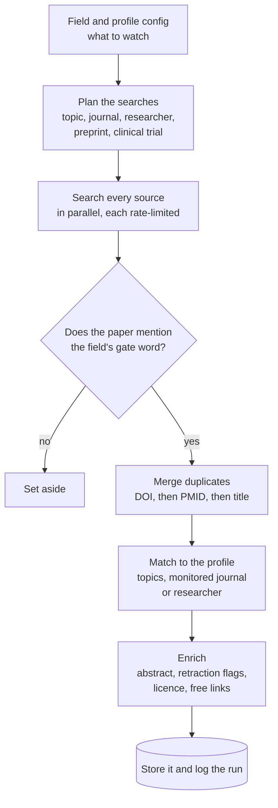
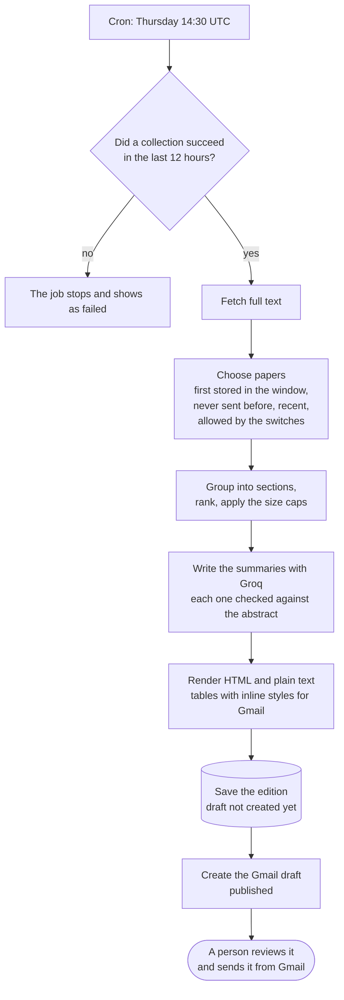
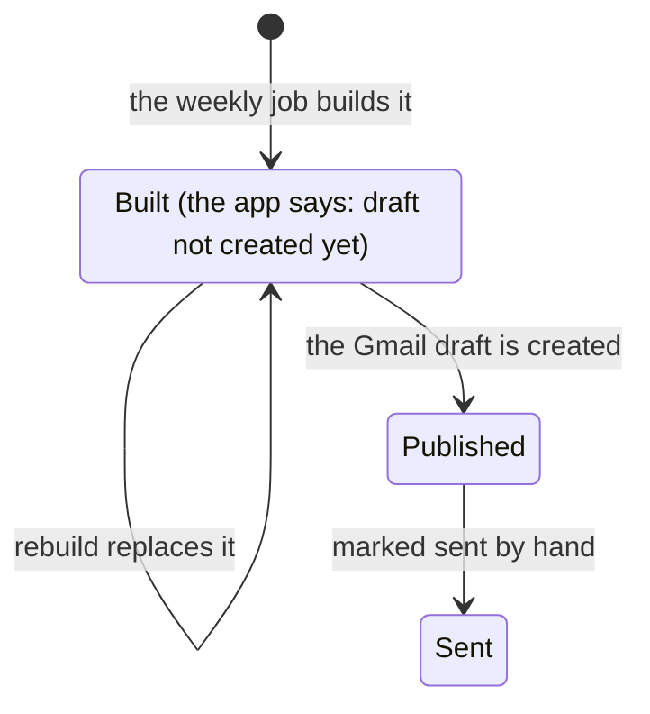
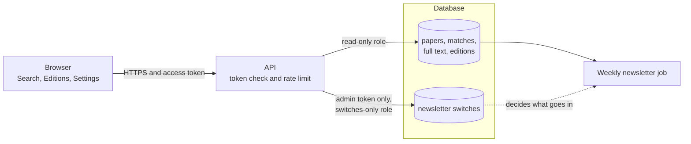
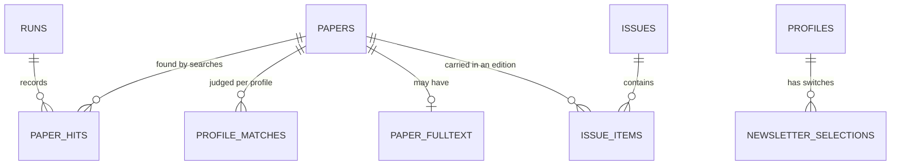
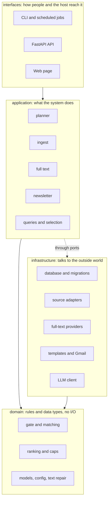
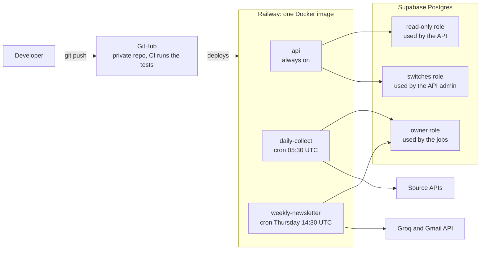

# Research Monitoring Agent

Keeping up with a research field means checking dozens of journals, databases and researchers every week. This agent does that for you.

Every day it searches the main scholarly sources and keeps the relevant papers in one database, with the full text where it can get it. Every week it writes a ready-to-review **newsletter into a Gmail draft**. A small **web app** lets the team search everything it has collected and tune what goes into the newsletter.

The first profile is **Curt: migraine research** (10 journals, 30 researchers, 12 topics). Everything specific to migraine lives in config files, not in code, so the same system can watch another field.

| What | When | Where you see it |
|---|---|---|
| Collect new papers | every day, 05:30 UTC | the database, the web app |
| Build the newsletter | Thursday 14:30 UTC (20:00 IST), dated Friday | a Gmail **draft**, the Editions tab |
| Search and tune | any time | the web app at `/app` |

> The agent **never sends email**. It creates a draft; a person reads it and presses send.

## What it looks like

**The weekly newsletter** (HTML for Gmail, plus a plain-text version): a summary of where the papers came from, then the papers grouped by topic, each with a short checked summary.


**The web app, Search tab:** coloured chips filter by source, journal, researcher and topic; every chip can be removed again.


**The web app, Editions tab:** every built newsletter, with a formatted preview, a phone-width view and the plain text.


_The screenshots use test data._

## How it works

### The big picture


Two scheduled jobs do the work and the database sits between everything: the **daily job** fills it, the **weekly job** reads from it to build the newsletter, and the **API and web app** let people search it and adjust the newsletter's settings.

### 1. Collecting papers every day



* **Several sources, on purpose.** No single source finds more than about half of the new papers, so the agent uses the union and records which source found what.
* **A failing source never stops the run.** Each source runs on its own with its own rate limit; the others carry on.
* **Safe to repeat.** Papers are de-duplicated, so running the same day twice adds nothing. Each run looks back three days, so one missed day is recovered by the next.
* **Retractions** are flagged from PubMed, Crossref and OpenAlex together; a retraction of something already sent is always announced.

### 2. Full text

After collecting, the agent tries to get the **full text** of stored papers. It tries providers in order (Europe PMC, Springer Nature open access, then free PDF copies) and stops at the first that works. Papers that reach PubMed Central later are picked up on later passes. When a paper has no abstract anywhere, the agent recovers one from its own text.

### 3. The weekly newsletter



An edition goes through three states:



A **published or sent edition is never rebuilt**, so what is in the Gmail draft always matches what is stored.

**How papers are chosen, in plain English**

* A paper goes into an edition by the date **our database first stored it**, not its publication date.
* **Never twice:** a paper appears in at most one edition.
* **Recent only:** papers published more than 7 days before we found them are left out.
* **Retractions come first**, in their own section.
* **Size is capped.** Papers held back by a cap may return in the **next** edition only, ranked a little lower. Papers from monitored journals and researchers are chosen first.
* **Summaries are checked.** The model sees only the title and abstract, and every number in its summary must appear in the abstract; otherwise a plain extract is used.
* Papers with **no abstract** go last in their section.
* The weekly edition is **dated Friday** even though it is built on Thursday evening; its content is everything stored up to the build.

### 4. The web app and API



* **Search:** words (every word must appear in the title or abstract), plus chip filters for sources, journals, researchers and topics, a published-date period, a full-text checkbox and sorting.
* **Editions:** every built newsletter, with a formatted preview.
* **Newsletter settings:** switch topics, journals, researchers and sources on or off for the **next newsletter only**. This never changes what is collected or what the search shows.
* **Safety:** every route needs a token. The data connection is read-only; the only thing the API can write is the on/off switches, with a separate admin token and its own database role.

### 5. The data



One row per paper, one row for each time a search found it, one match per profile, and a frozen copy of every newsletter edition.

## For developers

### How the code is organised



| Folder | What is in it |
|---|---|
| `src/research_agent/domain/` | rules and data types: the gate, ranking, retraction signals, config models |
| `src/research_agent/application/` | planner, ingest, full text, newsletter builder, queries and selection |
| `src/research_agent/infrastructure/` | database (SQLAlchemy, Alembic), one adapter per source, full-text providers, rendering |
| `src/research_agent/interfaces/` | the FastAPI API and the web page |
| `src/research_agent/templates/` | the newsletter templates (HTML and text) |
| `config/` | what a field means (`fields/`) and what a profile watches (`profiles/`) |
| `migrations/` | database migrations |
| `tests/` | 536 offline tests with saved real API responses |

**Principles:** configuration, not code, says what the field is; each source is isolated; every run is safe to repeat; the API is read-only except for the switches; the agent only ever creates drafts; tests run offline.

### Get started

You need Python 3.12.

```bash
uv venv --python 3.12 .venv && uv pip install --python .venv/bin/python -e ".[dev]"
cp .env.example .env                       # fill in what you have; every credential is optional
.venv/bin/research-agent db upgrade        # create the database (SQLite by default; Postgres via DATABASE_URL)
.venv/bin/research-agent seed              # load config/ into the database
.venv/bin/research-agent collect           # one daily run
.venv/bin/research-agent newsletter build  # build this week's edition
.venv/bin/research-agent api token         # make an access token (printed once)
API_TOKENS=<that token> .venv/bin/research-agent api   # the web app at http://127.0.0.1:8000/app
.venv/bin/python -m pytest                 # run the tests
```

| Command | What it does |
|---|---|
| `research-agent plan` | list the searches a run would make |
| `research-agent collect --date 2026-10-30` | replay a day; `--sources` and `--paths` narrow it |
| `research-agent fulltext` | fetch full text (add `--dry-run` to see the routes) |
| `research-agent newsletter build --week-ending YYYY-MM-DD` | build an edition; `--rebuild` replaces an unpublished one |
| `research-agent newsletter publish <key> --to file` or `--to gmail` | write draft files, or create the Gmail draft |
| `research-agent job daily` / `job weekly` | what the hosting cron runs |
| `research-agent status` | recent runs |
| `research-agent papers --days 7` | what the last week stored |
| `research-agent providers` | which sources and full-text routes are on |
| `research-agent gmail authorize` | one-time Gmail sign-in |

### Configuration

* **`config/fields/*.yaml`**: what a field means: the gate word, topics and the list of mechanism links.
* **`config/profiles/*.yaml`**: one profile's journals, researchers, newsletter wording, colours, caps and ranking weights.
* **`.env`**: credentials and hosting settings. Names only, copy `.env.example`:

| Group | Variables |
|---|---|
| Database | `DATABASE_URL`, `API_DATABASE_URL`, `API_ADMIN_DATABASE_URL` |
| Sources | `CONTACT_EMAIL`, `NCBI_API_KEY`, `OPENALEX_API_KEY`, `SPRINGER_API_KEY`, `CROSSREF_PLUS_TOKEN` |
| Summaries | `LLM_BASE_URL`, `LLM_API_KEY`, `LLM_MODEL` |
| Gmail | `GOOGLE_CLIENT_ID`, `GOOGLE_CLIENT_SECRET`, `GOOGLE_REFRESH_TOKEN`, `NEWSLETTER_RECIPIENTS` |
| API | `API_TOKENS`, `API_ADMIN_TOKENS`, `API_RATE_LIMIT_PER_MINUTE`, `API_CLIENT_IP_HEADER` |
| Jobs | `JOB_OVERLAP_DAYS`, `JOB_FULLTEXT_LIMIT` |

Secrets are read from `.env` (git-ignored) and scrubbed from errors and logs.

**Another field or profile:** copy `config/profiles/curt.yaml` and `config/fields/migraine.yaml`, change the gate word, journals, researchers and topics, then run `seed --profile <id>` and `collect --profile <id>`. Nothing in `src/` mentions migraine.

### Deployment



Railway runs the three services from one `Dockerfile`; Supabase holds the database. The step-by-step setup is in [DEPLOYMENT.md](DEPLOYMENT.md).

## More documentation

| File | What it holds |
|---|---|
| [docs/REFERENCE.md](docs/REFERENCE.md) | the detailed reference: every setting, the full API, newsletter rules, Gmail setup |
| [DEPLOYMENT.md](DEPLOYMENT.md) | Railway and Supabase setup, schedules, first checks, recovery |
| [Pipeline_design_plan.md](Pipeline_design_plan.md) | the design and why it is the way it is |
| [Progress.md](Progress.md) | what is done, what is open, decisions taken |
| `Journal_source_validation.md`, `Researchers_source_validation.md`, `Discovery_API_check.md`, `Window_filter_tests.md` | the live checks of every source |

## Status

The collection, the full-text stage, the weekly newsletter, the web app and the hosting are built and deployed. Still ahead: a printable PDF edition (waiting for the client's template) and, for v2.0, multi-user sign-up, search inside the full text and search by meaning. See [Progress.md](Progress.md).
