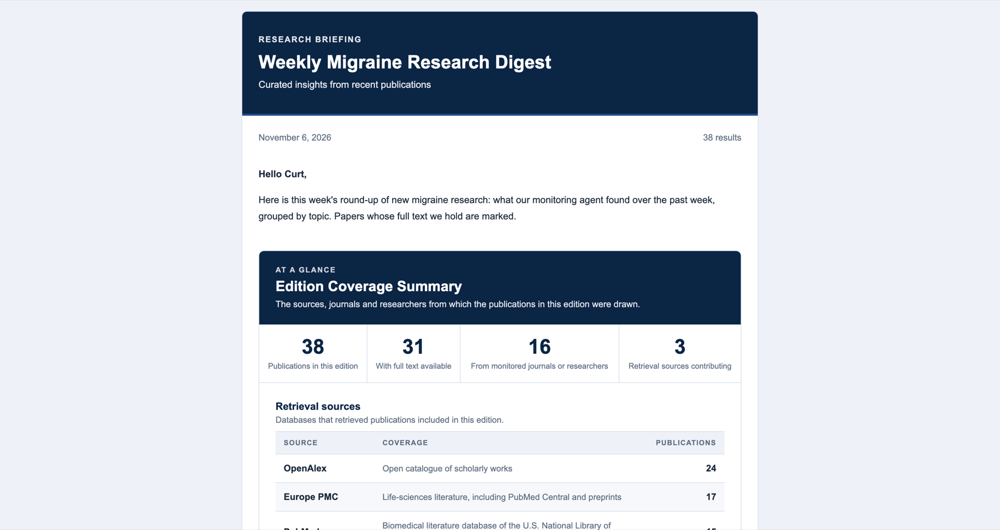
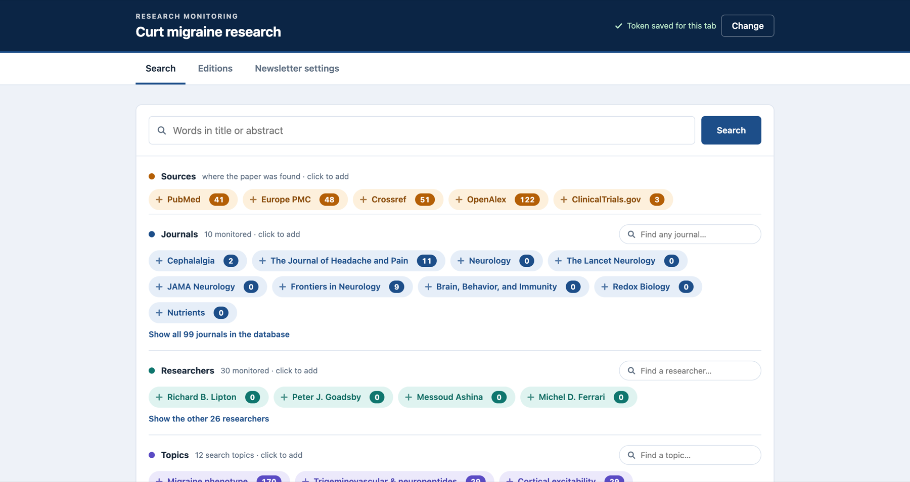
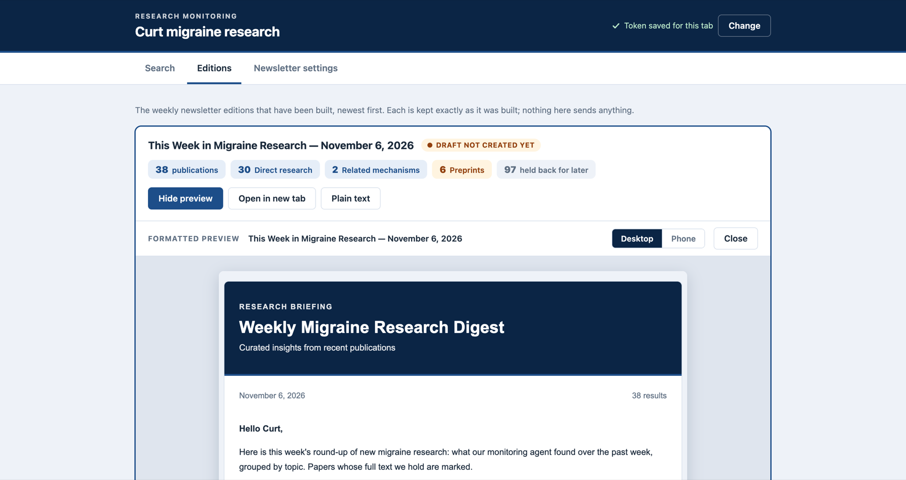
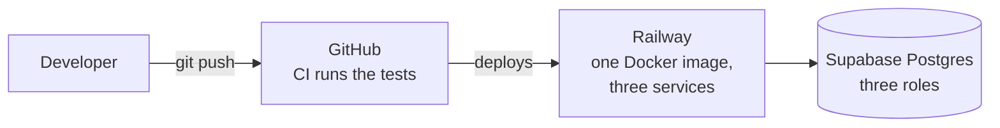

# Research Monitor

> A scheduled ingestion pipeline, a PostgreSQL store, a token-protected REST API with a small web app, and a weekly newsletter generator, for keeping up with a research field.

Every day the service searches the main scholarly sources, de-duplicates and enriches what it finds, and stores it with the full text where it can get it. Every week it renders a **newsletter into a Gmail draft** for a person to review and send. A **REST API and web app** let the team search the whole collection and tune what goes into the next newsletter.

The first deployment is **Curt: migraine research** (10 journals, 30 researchers, 12 topics). What counts as relevant lives in YAML config, not in code, so the same service can watch another field.

_Naming note: the Python package and the CLI are still called `research_agent` and `research-agent`, from the project's first design._

> The service **never sends email**. It creates a draft; a person reads it and presses send.

## At a glance

| Service | Trigger | What it does |
|---|---|---|
| `daily-collect` | cron, 05:30 UTC | search the sources, merge, match, enrich, store |
| `weekly-newsletter` | cron, Thursday 14:30 UTC (20:00 IST) | fetch full text, select, summarise, render, create the Gmail draft; the edition is dated Friday |
| `api` | always on | REST API under `/v1` and the web app at `/app` |

| Stack | |
|---|---|
| Language | Python 3.12 |
| API | FastAPI, uvicorn, pydantic v2 |
| Data | PostgreSQL (Supabase) in production, SQLite for local work; SQLAlchemy 2 and Alembic migrations |
| Ingestion | httpx client with per-host pacing, retries and back-off; one thread per source |
| Rendering | Jinja2: HTML tuned for Gmail's compose window, plus plain text |
| Summaries | any OpenAI-compatible endpoint (Groq); used for summaries only |
| Hosting | Docker image on Railway (one API service and two cron jobs), database on Supabase |
| Quality | pytest, 536 offline tests against recorded API responses; GitHub Actions runs them |

## What it looks like

**The weekly newsletter** (HTML for Gmail, plus a plain-text version): where the papers came from, then the papers grouped by topic, each with a short checked summary.



**The web app, Search tab:** chip filters over sources, journals, researchers and topics, all backed by `GET /v1/papers`.



**The web app, Editions tab:** every built newsletter, with a formatted preview, a phone-width view and the plain text.



_The screenshots use test data._

## How it works


Two scheduled jobs and one API service share a database and never call each other. The **daily job** fills it, the **weekly job** reads it to build a newsletter, and the **API** serves both, with a read-only connection for data and a separate switches-only connection for the newsletter settings.

**Selection rules, in plain English**

* A paper goes into an edition by the date **our database first stored it**, not its publication date.
* **Never twice:** a paper appears in at most one edition (a database constraint enforces it).
* **Recent only:** papers published more than 7 days before we found them are left out.
* **Retractions come first**, in their own section.
* **Size is capped.** Papers held back by a cap may return in the **next** edition only, ranked a little lower. Papers from monitored journals and researchers are chosen first.
* **Summaries are validated.** The model sees only the title and abstract, and every number in its summary must appear in the abstract; otherwise a plain extract is used.
* The edition is **dated Friday** even though it is built on Thursday evening; its content is everything stored up to the build.

## Architecture study

The design is written up as a short series, each chapter beginning with an **In short** box.

| # | Chapter | What you will learn |
|---|---|---|
| 1 | [High-level design](docs/architecture/01-high-level-design.md) | requirements, scope, architectural style, system context, containers, deployment, quality attributes |
| 2 | [Low-level design](docs/architecture/02-low-level-design.md) | layers and ports, identity merge, the relevance gate, ranking and caps, summary validation, the job runner |
| 3 | [API design](docs/architecture/03-api-design.md) | resources, authentication, rate limiting, search semantics, switches, errors, security headers |
| 4 | [Data design](docs/architecture/04-data-design.md) | the 24 tables, the constraints that carry business rules, indexes, migrations, row level security |
| 5 | [Reliability, security and operations](docs/architecture/05-reliability-security-operations.md) | failure modes, idempotency, threat model, CI and deployment, testing strategy |
| 6 | [Decision log](docs/architecture/06-decision-log.md) | sixteen decisions: why, the cost, and what was rejected |

A [glossary and reading paths](docs/architecture/README.md) help you find the right chapter fast.

## Get started

You need Python 3.12.

```bash
uv venv --python 3.12 .venv && uv pip install --python .venv/bin/python -e ".[dev]"
cp .env.example .env                       # fill in what you have; every credential is optional
.venv/bin/research-agent db upgrade        # create the database (SQLite by default; Postgres via DATABASE_URL)
.venv/bin/research-agent seed              # load config/ into the database
.venv/bin/research-agent collect           # one daily run
.venv/bin/research-agent newsletter build  # build this week's edition
.venv/bin/research-agent api token         # make an access token (printed once)
API_TOKENS=<that token> .venv/bin/research-agent api   # API and web app at http://127.0.0.1:8000/app
.venv/bin/python -m pytest                 # run the tests
```

| Command | What it does |
|---|---|
| `research-agent plan` | list the searches a run would make |
| `research-agent collect --date 2026-10-30` | replay a day; `--sources` and `--paths` narrow it |
| `research-agent fulltext` | fetch full text (add `--dry-run` to see the routes) |
| `research-agent newsletter build --week-ending YYYY-MM-DD` | build an edition; `--rebuild` replaces an unpublished one |
| `research-agent newsletter publish <key> --to file` or `--to gmail` | write draft files, or create the Gmail draft |
| `research-agent job daily` / `job weekly` | what the hosting cron runs |
| `research-agent status` | recent runs |
| `research-agent papers --days 7` | what the last week stored |
| `research-agent providers` | which sources and full-text routes are on |
| `research-agent gmail authorize` | one-time Gmail sign-in |

### Configuration

* **`config/fields/*.yaml`**: what a field means: the gate word, topics and the list of mechanism links.
* **`config/profiles/*.yaml`**: one profile's journals, researchers, newsletter wording, colours, caps and ranking weights.
* **`.env`**: credentials and hosting settings (names only; copy `.env.example`):

| Group | Variables |
|---|---|
| Database | `DATABASE_URL`, `API_DATABASE_URL`, `API_ADMIN_DATABASE_URL` |
| Sources | `CONTACT_EMAIL`, `NCBI_API_KEY`, `OPENALEX_API_KEY`, `SPRINGER_API_KEY`, `CROSSREF_PLUS_TOKEN` |
| Summaries | `LLM_BASE_URL`, `LLM_API_KEY`, `LLM_MODEL` |
| Gmail | `GOOGLE_CLIENT_ID`, `GOOGLE_CLIENT_SECRET`, `GOOGLE_REFRESH_TOKEN`, `NEWSLETTER_RECIPIENTS` |
| API | `API_TOKENS`, `API_ADMIN_TOKENS`, `API_RATE_LIMIT_PER_MINUTE`, `API_CLIENT_IP_HEADER`, `API_DOCS` |
| Jobs | `JOB_OVERLAP_DAYS`, `JOB_FULLTEXT_LIMIT` |

**Another field or profile:** copy `config/profiles/curt.yaml` and `config/fields/migraine.yaml`, change the gate word, journals, researchers and topics, then run `seed --profile <id>` and `collect --profile <id>`. Nothing in `src/` mentions migraine.

**A quick API call:**

```bash
curl -H "Authorization: Bearer $TOKEN" \
  "https://<host>/v1/papers?journal=cephalalgia&source=pubmed&published_from=2026-10-01&sort=relevance"
```

Set `API_DOCS=true` to serve the OpenAPI docs at `/docs`; the full route list and its design are in [chapter 3](docs/architecture/03-api-design.md).

## Deployment



The database is reached through three roles: the **owner** (the cron jobs), a **read-only** role (the API's data routes) and a **switches-only** role (the API's settings route), so the public API never holds the owner's credentials. Step-by-step setup is in [DEPLOYMENT.md](DEPLOYMENT.md); what to do when a job fails is in [chapter 5](docs/architecture/05-reliability-security-operations.md#51-failure-modes).

## More documentation

| File | What it holds |
|---|---|
| [docs/architecture/](docs/architecture/README.md) | the design study: HLD, LLD, API, data, reliability and security, decisions |
| [docs/REFERENCE.md](docs/REFERENCE.md) | the detailed reference: every setting, the full API parameters, newsletter rules, Gmail setup |
| [DEPLOYMENT.md](DEPLOYMENT.md) | Railway and Supabase setup, schedules, first checks, recovery |
| [Pipeline_design_plan.md](Pipeline_design_plan.md) | the original design plan and its evidence |
| [Progress.md](Progress.md) | what is done, what is open, decisions taken |
| `Journal_source_validation.md`, `Researchers_source_validation.md`, `Discovery_API_check.md`, `Window_filter_tests.md` | the live checks of every source |

## Status

The ingestion pipeline, the full-text stage, the weekly newsletter, the REST API and web app, and the hosting are built and deployed. Still ahead: a printable PDF edition (waiting for the client's template) and, for v2.0, multi-user sign-up, search inside the full text and search by meaning. See [Progress.md](Progress.md).
