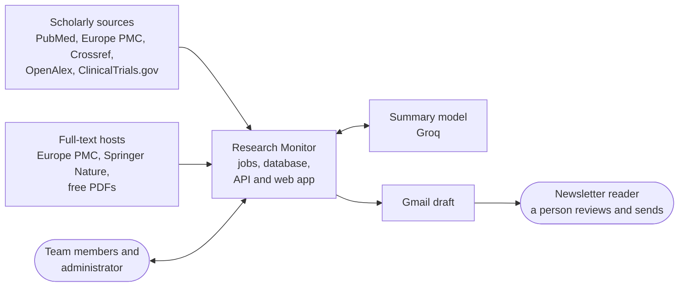
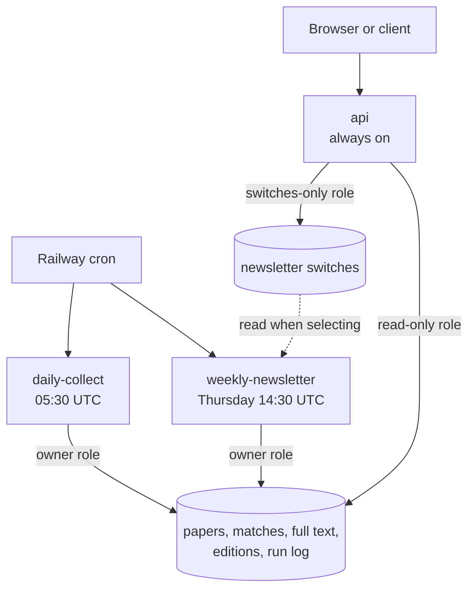
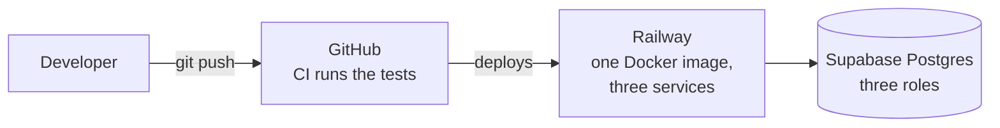

# 1. High-level design

> **In short.** A **modular monolith** with three entry points, run from one Docker image: a daily collection job, a weekly newsletter job, and an API with a web app. They share one PostgreSQL database and never call each other: the database is the integration point. Everything specific to a research field lives in configuration, so the same code can watch another field.

## 1.1 The problem

Keeping up with a research field means checking dozens of journals, databases and researchers every week, and no single source is complete. Someone has to collect the new papers, remove the duplicates, judge which ones matter, read or summarise them, and write it all up for a busy reader, week after week, without sending the same paper twice or missing a retraction.

## 1.2 Goals and non-goals

| Goals | Non-goals (today) |
|---|---|
| Collect new papers every day from several independent sources | Real-time alerts; the rhythm is daily and weekly |
| Keep every paper once, with its provenance, full text and flags | Sending email: the service only creates drafts |
| Produce one reviewable newsletter a week, never repeating a paper | A printable PDF edition (waiting for a client template) |
| Let people search the collection and tune what the newsletter picks | Multi-user accounts and per-user sources (planned for v2.0) |
| Be configurable per field, with no code change | Search by meaning, or inside the full text (planned for v2.0) |

## 1.3 Requirements

**Functional**

| # | The system must |
|---|---|
| F1 | search five sources every day and keep only papers relevant to the field |
| F2 | recognise the same paper across sources and merge it into one record |
| F3 | flag retracted papers and keep them out of normal listings |
| F4 | fetch the full text of papers where a legal free route exists |
| F5 | build a weekly newsletter (HTML and plain text) with summaries and create a Gmail draft |
| F6 | never put a paper into two editions, and announce retractions of papers already sent |
| F7 | expose search over the collection through an API and a web app |
| F8 | let an administrator switch topics, journals, researchers and sources on or off for the next newsletter only |

**Non-functional**

| Quality | Target | How it is met (details in [chapter 5](05-reliability-security-operations.md)) |
|---|---|---|
| Correctness | no duplicates, no repeats | unique constraints in the database, idempotent merge |
| Reliability | one broken source or step never ruins the week | per-source isolation, a 3-day look-back, a freshness guard on the weekly job |
| Safety | the program cannot email anyone | it only creates drafts; a person sends |
| Security | the public API cannot change papers | read-only role, separate switches-only role, tokens, rate limits |
| Evolvability | a new field, source or full-text route is cheap to add | config-driven design, ports and adapters |
| Cost | small and predictable | one small service, paced and cached model calls |
| Observability | an operator can tell what happened | every search and run is logged in the database |

**Scale** (measured, not guessed): about 20 new relevant papers a day, so roughly 7,000 a year; a weekly edition of 30 to 40 papers; in a test sample, a stored full text averaged 45 KB. This is a small system: it needs a reliable design, not a distributed one.

## 1.4 Architectural style

A **batch pipeline around a shared database**, with a thin read-mostly API on top:

* The daily and weekly jobs are short-lived processes started by a cron scheduler. They do their work, write to the database and exit.
* The API is a long-running stateless process. It never calls the sources; it only reads what the jobs stored (and writes the on/off switches).
* One codebase, one image, three start commands. Inside, the code is layered as ports and adapters, so the rules do not depend on any particular source, database or mail service.

**Why not microservices or a message queue?** The data is small, the rhythm is daily and weekly, and a failure just means "run it again". Separate services and a queue would add moving parts, deployment work and failure modes without solving a problem the system has. The decision and its alternatives are in the [decision log](06-decision-log.md), entries D1 and D2.

## 1.5 System context

Who and what the system talks to:

The only things that leave the system are **Gmail drafts** and **API responses**. Nothing is pushed to a reader automatically.

## 1.6 Containers (runtime units)

| Unit | Lifetime | Reads | Writes | Why it is separate |
|---|---|---|---|---|
| `daily-collect` | minutes, once a day | the sources, config | papers, hits, matches, run log | slow, network-bound, independent of readers |
| `weekly-newsletter` | minutes, once a week | the database, full-text hosts, the model | full text, summaries, editions | a different rhythm; depends on fresh data |
| `api` | always on | the database | only the on/off switches | must never hold the owner's credentials |

## 1.7 How the data flows

1. **Plan.** The profile and field config become concrete searches (topic, journal, researcher, preprint, trial).
2. **Discover.** Each source is queried in its own thread, paced and retried.
3. **Gate and merge.** A record must mention the field's word; duplicates collapse into one paper by DOI, then PMID, then title.
4. **Match and enrich.** The paper is matched to the profile (topics, monitored journal or researcher), then enriched with an abstract, retraction state, licence and free links.
5. **Full text.** Providers are tried in order until one returns text.
6. **Select.** Papers first stored in the window, never sent before, recent, and allowed by the switches become candidates.
7. **Rank and cap.** Papers are grouped into sections, scored, and trimmed to the size limits.
8. **Summarise.** The model writes a short summary per paper; each is validated against the abstract.
9. **Render and freeze.** HTML and text are rendered and saved as an immutable edition.
10. **Draft.** A Gmail draft is created; a person reviews and sends it.
11. **Serve.** The API and web app expose the collection and the editions.

The low-level design of each step is in [chapter 2](02-low-level-design.md).

## 1.8 The weekly rhythm

| What | UTC | IST | Note |
|---|---|---|---|
| Daily collection | every day 05:30 | 11:00 | about two minutes |
| Weekly job | Thursday 14:30 | 20:00 | needs a successful collection in the last 12 hours |
| Edition date | Friday | Friday | the label is the next Friday; the content is everything stored up to the build |
| A person reviews and sends | Friday | Friday | from Gmail |

The weekly job runs nine hours after that day's collection, so Thursday's papers are always in. Friday's collection goes into the following Thursday's edition.

## 1.9 Deployment

The database is reached through **three roles**, so each unit gets only the rights it needs:

| Role | Used by | Can |
|---|---|---|
| owner | the two cron jobs | read and write everything |
| read-only | the API's data routes | read ten tables, in read-only transactions |
| switches-only | the API's settings route | read and write only the newsletter switches table |

Configuration is environment variables (the twelve-factor way); secrets never enter the image. Each job runs database migrations first, so a pushed schema change is applied by the next run. Step-by-step setup is in [DEPLOYMENT.md](../../DEPLOYMENT.md).

## 1.10 Quality attributes and tactics

| Attribute | Tactic | Where |
|---|---|---|
| Reliability | isolate each source; overlap each run by three days; record every outcome | ingest pipeline |
| Reliability | refuse the weekly run without a fresh collection; stop hung jobs | job runner |
| Correctness | uniqueness enforced by the database, not only by code | data design |
| Security | least-privilege roles, read-only sessions, constant-time token checks, rate limits, strict CSP | API and data design |
| Evolvability | rules in the domain layer, I/O behind ports, field behaviour in YAML | low-level design |
| Testability | pure domain functions, injected clocks and transports, recorded API responses | operations |

## 1.11 Known limits

* **One process for the API's rate limiter.** The limiter is in memory, which is correct for one server process; running several would need a shared limiter in front.
* **Keyword search only.** Search is plain word matching on titles and abstracts; full-text and meaning-based search are planned for v2.0.
* **One profile per API process.** `API_PROFILE` selects it; accounts and per-user views are v2.0.
* **No queue.** A failed job is re-run, which is safe because every step is idempotent.

**Next:** [2. Low-level design](02-low-level-design.md).
