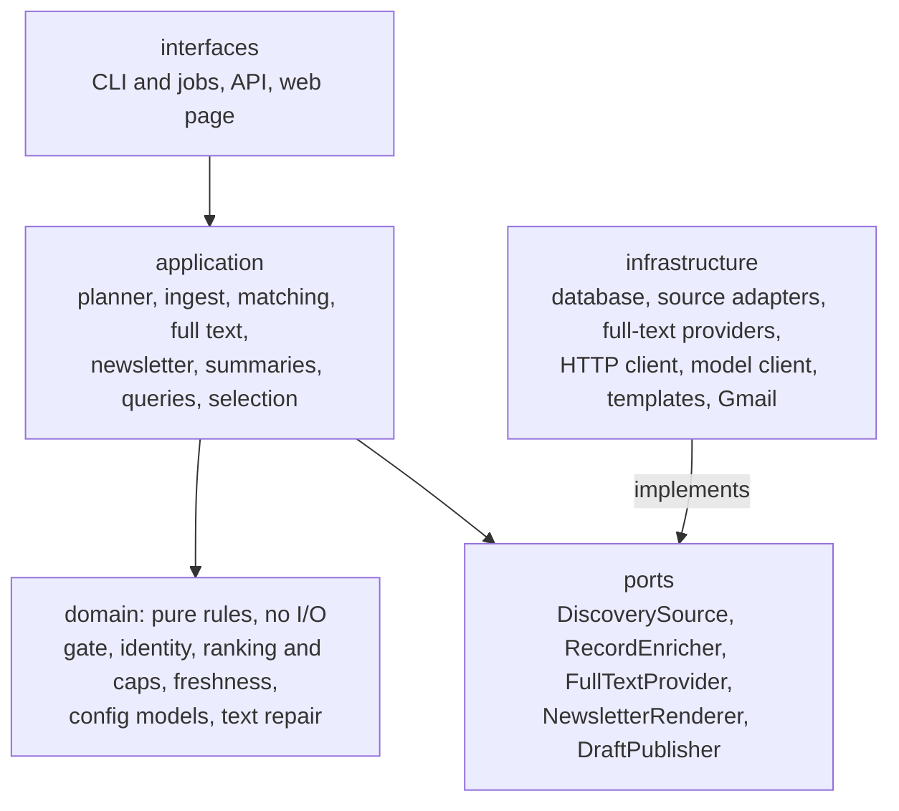
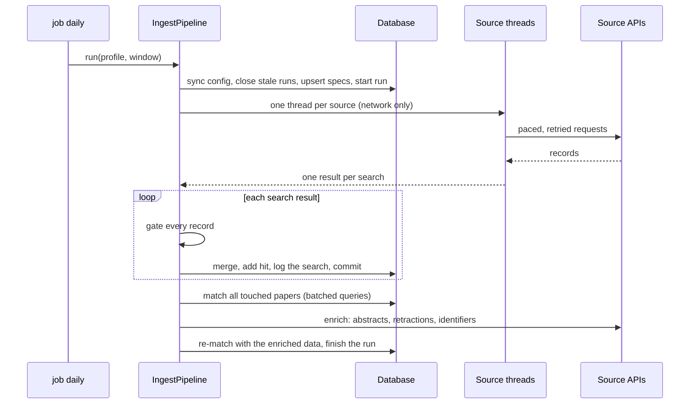
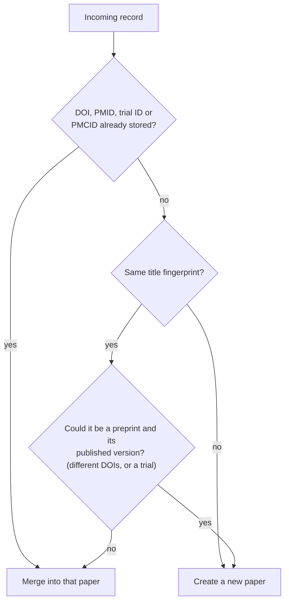
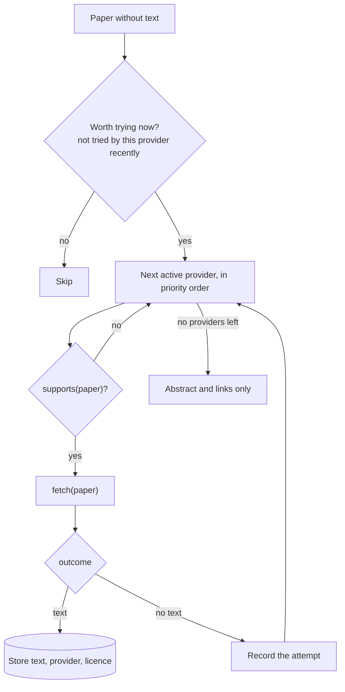
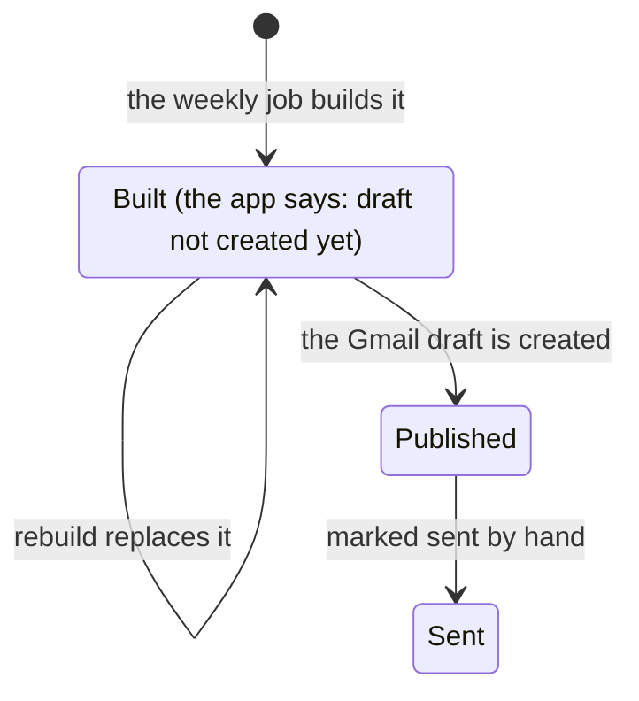
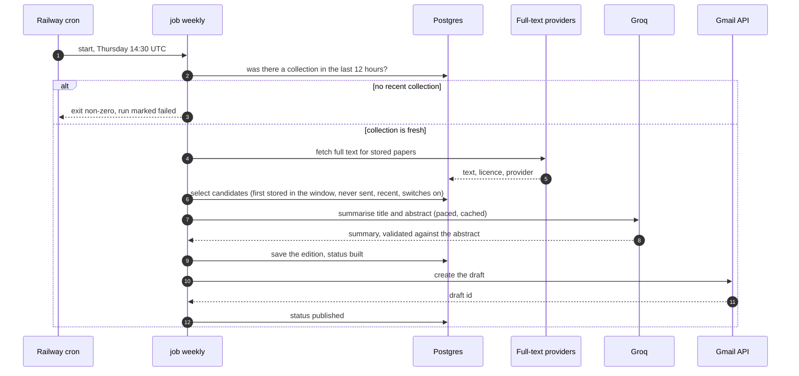

# 2. Low-level design

> **In short.** The code is layered: a **domain** of pure rules with no I/O, an **application** layer that orchestrates them, **infrastructure** adapters for the database, sources, full-text hosts, mail and the model, and thin **interfaces** (CLI, API, web page). The interesting logic lives in a handful of small algorithms: identity merge, the relevance gate, ranking and caps, and summary validation. This chapter explains each one.

## 2.1 Layers and the dependency rule



**The rule:** arrows point inward. The domain imports nothing from the layers above it, so it can be tested with plain function calls and no database. Infrastructure plugs into the application only through the protocols in `ports.py` (it also uses the domain's data types):

| Port | What it promises | Implemented by |
|---|---|---|
| `DiscoverySource` | `run(spec, window)` returns a result and **never raises** for source failures | one adapter per source |
| `RecordEnricher` | look up papers by DOI and return extra facts (retraction, licence, links, abstract) | Crossref, OpenAlex, Europe PMC adapters |
| `FullTextProvider` | `active()`, `supports(req)` (no network), `fetch(req)` returning an outcome, never raising | one class per route |
| `NewsletterRenderer` | turn an edition's data into HTML and text | the Jinja2 renderer |
| `DraftPublisher` | put an edition where a person can review it; **never sends** | file and Gmail publishers |

Adapters are wired together in `bootstrap.py`; nothing else knows which concrete class is in use.

## 2.2 Configuration as data

A **field** (what the topic means) and a **profile** (what one client watches) are YAML files, validated by pydantic models in `domain/field_config.py` and then synced into the database at the start of each run (`sync_config`, which stores the config together with a content hash).

| Config | Controls |
|---|---|
| field | the gate terms (the word a paper must mention), subjects and their terms, the approved list of mechanism links |
| profile | journals (ISSNs, tier), researchers (ORCID, OpenAlex IDs), newsletter wording, colours, ranking weights, caps, freshness, timing, app link |

Nothing in `src/` mentions migraine. Validation rejects bad settings at load time (for example an `https`-only app link, a weekday outside 0 to 6, a colour that is not `#rrggbb`).

## 2.3 The search planner

`application/planner.py` turns config into concrete `SearchSpec` rows: a path (what kind of search), a source, parameters, whether the source query is already gated, and metadata that says *why* the search exists (for example "this one is for journal X").

| Path | What it searches | Confidence of its hits |
|---|---|---|
| topic | the field's gate word in every index | query |
| journal | one PubMed query per journal; one Crossref query per ISSN | id (a journal match is by ISSN) |
| researcher | PubMed by name; OpenAlex by confirmed ID | name, or id for OpenAlex |
| preprint | Europe PMC preprints | query |
| trial | ClinicalTrials.gov | query |
| bridge | approved mechanism links only; empty until approved | query |

Subjects are **not** searched separately: every search already carries the gate word, so a per-subject query would only be a subset. Subjects classify papers locally, which saves requests. Specs are stored in `search_specs` with a stable key, and specs no longer in the config are retired.

## 2.4 Source adapters and the HTTP client

An adapter translates a `SearchSpec` and a date window into one source's API calls and returns normalised `PaperRecord`s. Each adapter uses a shared `HttpClient`:

* **Pacing.** A per-host `RateLimiter` enforces a minimum interval between requests, safely across threads (a lock and a "next allowed time").
* **Retries.** Statuses 429, 500, 502, 503 and 504 are retried (up to four tries) with back-off `2^(attempt+1)` seconds, capped at 60, or the server's `Retry-After` if it sends one. Other errors fail at once. A plan-limit response is not retried.
* **Redirects.** Followed up to five times; credentials are sent only to the original host.
* **Secrets.** Keys are scrubbed from every error message before it is stored or logged.
* **Failure contract.** An adapter that hits an error returns a result with `error` set. If an adapter crashes anyway, the ingest pipeline catches it and records `adapter crashed: ...` so the other sources continue.

## 2.5 The ingest run



Design points:

* **Threads do network only.** Database access happens on the calling thread, so no session is shared across threads.
* **Commit per search.** Progress survives a job that is stopped part-way; later steps redo matching for those papers.
* **Batched lookups.** Matching reads all hits and existing matches for a run in two queries, not two per paper (this took the first production run from about 23 minutes to about two).
* **Run status** is computed, not guessed: `failed` if no search worked, `partial` if there were errors, suspicious zeros or truncation, otherwise `ok`.
* **Silent-zero alarm.** A search that normally returns results (median of the last seven runs at least 5, with at least three runs of history) but returns none is recorded as `suspect_zero`: it usually means an API or filter changed.
* **Stale runs.** A run left "running" by a crash is closed as failed after three hours, so monitoring never treats it as live.

## 2.6 Identity resolution and merge

Sources call the same paper by different identifiers, so every record goes through `find_paper` and `merge_record`.



The **title fingerprint** is a SHA-1 of the title lower-cased, stripped of accents, tags and punctuation, shortened to 20 characters; titles shorter than 25 normalised characters get none, because they identify nothing.

How fields merge (so the result does not depend on which source arrived first):

| Field | Rule |
|---|---|
| identifiers (DOI, PMID, PMCID, trial ID) | set when empty, and only if no other paper already holds that value |
| title | the first title; PubMed or Europe PMC replace it if theirs is at least as long |
| abstract | the longest one wins |
| journal, ISSNs, languages, publication types, licences | first value kept for single fields; sets are unioned |
| authors | the longest list |
| publication date | the first known one; the earliest entry date is kept |
| retraction | flags are OR-ed and every flagging source is recorded |
| `first_seen_at` | set once when the paper is created, never changed |

## 2.7 The relevance gate, language and track

A record must be relevant to the field. `FieldMatcher.evaluate_gate` returns one of three verdicts:

| Verdict | When |
|---|---|
| **passed** | the gate word appears in the title or abstract; or an approved mechanism link does (then it is marked exploratory); or the source query was already gated and the record has no abstract to check |
| **failed** | an abstract exists and contains no gate word: the paper is set aside |
| **unknown** | no abstract and an ungated source: enrichment asks other sources for an abstract; if still unknown it is stored but not treated as relevant |

Term matching is a compiled regular expression: it must not touch other letters or digits on its left; prefix terms accept any word tail; plain terms accept a plural (`s`, `es`); acronyms and mixed identifiers such as `CGRP` or `CoQ10` are matched case-sensitively.

For papers that pass, `classify_subjects` records which subjects matched and whether the match was **specific** (not just the field word itself). `decide_track` then picks a track: direct evidence wins; the mechanism track applies only when every specific signal is mechanism-only. Language is `ok`, `unknown` (kept, because a source sometimes leaves it empty) or `other`.

## 2.8 Matching a paper to a profile

`ProfileMatcher` produces one `profile_matches` row per (profile, paper) with the gate, language, track, subjects and the **entities** that make the paper matter:

* a hit from a journal or researcher search carries that entity and the search's confidence;
* an ISSN equal to a monitored journal's ISSN adds the journal at the highest confidence;
* an author ORCID equal to a monitored researcher's adds the researcher at the highest confidence.

Confidence is ranked `id` (3) over `name` (2) over `query` (1) over `name_ambiguous` (0), and the best evidence for each entity wins. A paper is **watched** if it has any entity not marked ambiguous; ambiguous name matches are never advertised or used to decide the track.

## 2.9 Enrichment

After matching, three batched lookups run, each only for the papers that need it:

1. papers whose gate is **unknown**: ask OpenAlex and Europe PMC for an abstract;
2. papers not yet checked: ask Crossref and OpenAlex for the retraction state, licence and free links;
3. relevant papers with no PubMed Central ID: ask Europe PMC for identifiers, because a PMC ID unlocks the cleanest full-text route.

Papers are then re-matched with the new data. Every retraction answer is stored in `retraction_checks`, so a paper is flagged if any source says so.

## 2.10 The full-text router



* Providers are tried in a fixed priority order: Europe PMC XML, Springer Nature open access, then free PDF copies converted with `pdftotext`. Providers for other publishers exist but stay inactive without credentials.
* Every attempt is recorded in `fulltext_attempts`; a provider that could not help is not asked again for a retry window (`fulltext.retry_days`), and a provider added later is tried on the papers earlier ones missed.
* **PMC lag.** A paper may get a PubMed Central ID weeks after publication, so each pass re-looks-up recent papers that still have none.
* **Verification.** A stored PDF is re-checked to be the right paper (its DOI or title in the first pages); a wrong text is removed and the attempt recorded so the same wrong link is not retried.
* **Abstract recovery.** A paper with no abstract anywhere gets one recovered from its own text (an Abstract or Summary heading, a structured block, or the opening of the text), with the source recorded in `abstract_source`.

## 2.11 Selecting and ranking for the newsletter

**Candidates.** A paper is a candidate when, for the profile, it passed the gate, its language is ok or unknown, it is not retracted and not a retraction notice, it is not an excluded content type, it was **first stored inside the window**, and it is **not already in any earlier edition's digest items**. Retractions are handled separately and announced once.

**Freshness.** `is_stale` drops a paper published more than 7 days before we first stored it. It uses the *latest possible* publication date: an exact date counts as itself, a month-only date counts as the last day of that month, a year-only date is unknown, and unknown is never stale, so a paper is dropped only when it is certainly old.

**Window and carry-over.** The first edition looks back 7 days; later ones look back 14. A paper first stored before the normal window is *carried over*: it was held back by an earlier edition. It loses 3 points of score, and because the candidate rule excludes anything already sent and the window is only 14 days, a held-back paper can return **once** and then drops out.

**Score.** A deterministic integer, with weights that are profile settings:

| Signal | Default points |
|---|---|
| monitored journal | 3 |
| monitored researcher | 3 |
| full text we hold and may print | 3 |
| the field word is in the title | 2 |
| matching subjects (each, up to 3) | 1 |
| has an abstract | 1 |
| core journal | 1 |
| carried over from an earlier edition | minus 3 |

**Caps.** `apply_caps` keeps the best items inside each section's limit (defaults: 30 direct, 15 mechanisms, 10 preprints, 10 trials), then inside an optional overall limit:

```text
rank(item)  = (not watched, -score, -paper_id)      # monitored sources first, then score, then newest
for each section:   sort by rank; keep the first N (or all if uncapped); the rest are "held back"
if overall cap:     sort non-retractions by rank; drop what is beyond (cap - retractions kept)
retractions are never removed by the overall cap
```

A final safety net trims the lowest-ranked non-retractions until the HTML is under `max_html_kb` (95), because Gmail clips messages near 100 KB. Papers with no abstract are moved to the end of their section.

## 2.12 Summaries

The model sees only the title and abstract, treated as untrusted text. Each answer must pass `check_summary` before it is used:

| Check | Why |
|---|---|
| not empty, at least 6 words, not more than 1.6 times the target length | catches refusals and rambling |
| contains no link | the model must not introduce URLs |
| **every number in it appears in the title or abstract** (spelled-out numbers are converted first) | the guard against invented figures |

One retry, then the edition falls back to an extract of the abstract. Good summaries are cached by `(paper, model, prompt version, abstract hash)`, so a rebuild makes no model calls and changing the abstract or the prompt invalidates only what it should. Calls are paced (about one every two seconds) and capped per run.

## 2.13 Rendering

HTML for a Gmail draft is constrained: Gmail's compose window drops `<style>` blocks, so every style is written inline and the layout is nested tables in a single 760 px column. The renderer builds one context (sections, the At a glance figures, colours, links) and renders two templates, HTML and plain text, from it. Page text is autoescaped for HTML only.

## 2.14 Editions: freezing and publishing

An **edition** is written once: `issues` stores the final HTML and text, the window, statistics and notes; `issue_items` stores one row per paper with a **snapshot** (title, journal, summary, score, group, full-text status) so what was sent can always be reconstructed. The unique key on `(profile, paper, role)` is what enforces "never twice".



Status moves `built` to `published` (a Gmail draft exists) to `sent` (marked by hand). A built edition may be rebuilt; a published or sent one never is. The Gmail publisher reuses the stored draft id if that draft still exists, so a rerun does not create a duplicate. The program only ever creates drafts.

## 2.15 The on/off switches

`newsletter_selections` stores what an administrator switched **off**, as `(profile, kind, key, enabled)`. Everything is on by default. The domain `Selection` answers one question, "may this paper enter the next edition?":

* it needs a **route in** that is still on: one of its topics, a monitored journal it came from, or a monitored researcher it came from; and
* at least one of the sources that found it must be on.

Retraction alerts are never filtered. A change is **all-or-nothing**: an unknown name, or a result that would leave the newsletter nothing to select from, changes nothing. Switches affect only the next newsletter, never collection or search.

## 2.16 The job runner

A job is a fixed list of the CLI's own commands, run in order, stopping at the first failure:

| Job | Steps |
|---|---|
| daily | database schema upgrade, seed the profile, collect (look back 3 days) |
| weekly | freshness guard (a successful collection in the last 12 hours), schema upgrade, fetch full text, build the edition, create the Gmail draft (only if Gmail credentials are set) |



A failing step makes the process exit non-zero, so the host marks the run failed. Because the host does not stop a hung run, each job installs a `SIGALRM` hard timeout (45 minutes daily, 150 weekly). The edition date comes from the profile's weekday setting.

## 2.17 Concurrency model

| Where | Model |
|---|---|
| ingest | one thread per source for network calls; database work on the calling thread |
| API | synchronous route handlers run in the framework's thread pool; one database session per query |
| jobs | single process, sequential steps |
| rate limiting | in memory, per process (see [chapter 3](03-api-design.md)) |

## 2.18 Extending the system

| To add | Do this |
|---|---|
| a discovery source | write an adapter implementing `DiscoverySource`, add its searches to the planner, register it in `infrastructure/registry.py`, add recorded-response tests |
| a full-text route | implement `FullTextProvider` (`info`, `active`, `supports`, `fetch`), register it, add tests |
| another field or client | copy a profile and a field YAML, change the gate word and watched items, then `seed` and `collect` |
| another publisher (not Gmail) | implement `DraftPublisher` |

**Next:** [3. API design](03-api-design.md).
