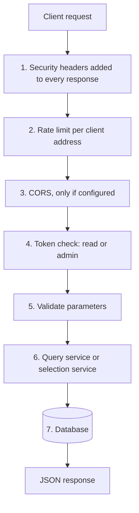
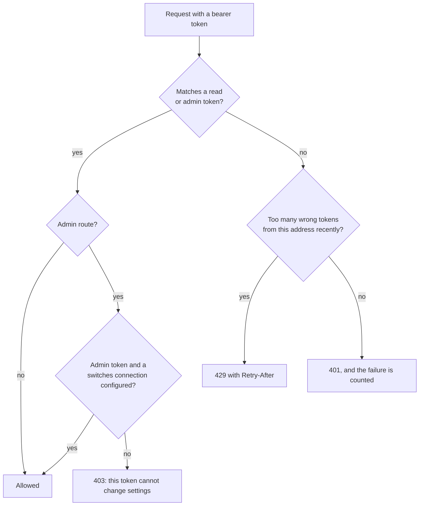

# 3. API design

> **In short.** A small, versioned (`/v1`), resource-oriented JSON API that is **read-mostly**: it searches what the jobs stored, shows editions and run health, and lets an administrator flip the newsletter's on/off switches. It is stateless, protected by bearer tokens (a read class and an admin class), rate-limited per client, and talks to the database through a read-only connection. The only write it can make is to the switches.

## 3.1 Design principles

| Principle | What it means here |
|---|---|
| Resource-oriented | nouns, not verbs: `papers`, `issues`, `newsletter/config`, `retractions`, `runs` |
| Read-mostly | every route is a `GET` except the settings; the API never searches sources or edits papers |
| Stateless | no sessions or cookies; each request carries its token |
| Least privilege | read tokens read; admin tokens can also change switches; the data connection cannot write |
| Predictable errors | one JSON error shape, meaningful status codes, `Retry-After` on throttling |
| Additive evolution | `/v1` only grows (new parameters, new response keys); breaking changes would be `/v2` |
| Safe by default | OpenAPI docs and CORS are off until switched on; the process refuses to start without a token |

## 3.2 The request pipeline



Every response, including errors and throttled ones, gets `Cache-Control: no-store`, `X-Content-Type-Options: nosniff` and `Referrer-Policy: no-referrer`. `/health` and `/ready` skip the rate limit so a platform health check can never be throttled.

## 3.3 Resources and routes

All routes are under `/v1` and need `Authorization: Bearer <token>` unless marked open.

| Method and route | Access | Purpose |
|---|---|---|
| `GET /health`, `GET /ready` | open | liveness; readiness (the database role works) |
| `GET /`, `GET /app`, `GET /app/app.js` | open | the web app (holds no data; the data routes need the token) |
| `GET /v1/papers` | read | the search (see 3.6) |
| `GET /v1/papers/filters` | read | what a search form can offer, with counts |
| `GET /v1/papers/{id}` | read | one paper: abstract, links, subjects, which searches found it, retraction notice, editions that carried it |
| `GET /v1/papers/{id}/fulltext` | read | the stored text (`?format=text` for plain text), with provider, licence and whether it is printable |
| `GET /v1/retractions` | read | retracted papers with their notice |
| `GET /v1/issues`, `/v1/issues/{key}` | read | editions with counts, window, held back and left out |
| `GET /v1/issues/{key}/html`, `/text` | read | the frozen edition body |
| `GET /v1/stats`, `/v1/runs`, `/v1/profile`, `/v1/whoami` | read | overview, recent runs, the watched journals and researchers, and how the server sees the caller's address |
| `GET /v1/newsletter/config` | read | what the newsletter is built from, each item with `enabled` |
| `PATCH /v1/newsletter/config` | **admin** | switch several items at once |
| `PUT /v1/newsletter/config/{kind}/{key}` | **admin** | switch one item (`kind`: `subjects`, `journals`, `researchers`, `sources`) |
| `DELETE /v1/newsletter/config` | **admin** | everything back on |

## 3.4 Authentication and authorisation

Two token classes, configured as lists in the environment (`API_TOKENS`, `API_ADMIN_TOKENS`). An admin token can read too.



Design details that matter:

* **Constant-time comparison.** The given token is compared with every configured token using `hmac.compare_digest`, with no early exit, so response time does not reveal how much of a token matched.
* **Lockout that cannot lock out real users.** After too many *wrong* tokens from one address, further wrong or missing tokens get 429. A *valid* token is never refused because of it. This matters behind a proxy, where many visitors share one address: an attacker must not be able to lock everyone out by failing on purpose.
* **401 versus 403.** 401 means "who are you?" (missing or wrong token). 403 means "known, but not allowed": a read token used on a settings route.
* **No cookies.** Authentication is a header, so cross-site request forgery does not apply.
* **Fail closed.** The API will not start without at least one token; with no admin token configured, nobody can change settings.

## 3.5 Rate limiting

A **sliding window** per client key: at most `API_RATE_LIMIT_PER_MINUTE` requests (default 120) in any 60 seconds, and a second, smaller window for wrong tokens (default 10 a minute). Over the limit the API answers 429 with a `Retry-After` in seconds.

* **Who is the client?** The connecting address, or, if `API_CLIENT_IP_HEADER` names a header the host's proxy sets, the last entry of that header. Only the configured header is believed. `GET /v1/whoami` shows what the server sees, so the setting can be checked after deployment.
* **Memory is bounded.** Empty keys are pruned and the table resets if it still outgrows its cap, so a flood of distinct addresses cannot exhaust memory.
* **Known limit.** The limiter lives in one process, which is correct for a single server process. Running several workers would give each its own count; a shared limiter in front would then be needed.

## 3.6 The search

`GET /v1/papers` is the heart of the API.

| Parameter | Meaning |
|---|---|
| `q` | words that must **all** appear in the title or abstract (case-insensitive, partial matches; `%` and `_` are escaped) |
| `journal` | a monitored journal's key (exact: by ISSN or exact name) or any text found in a journal name; repeatable |
| `researcher` | a monitored researcher's key or full name; matched by **confirmed identity**, never by name text; repeatable |
| `source` | a discovery source that found the paper (`pubmed`, `europepmc`, `crossref`, `openalex`, `ctgov`); repeatable |
| `topic` | a search topic's code or name; repeatable |
| `author` | author-name words, accents and case ignored; every word must be in the same paper's author list; repeatable |
| `published_from`, `published_to` | publication date range (papers with no exact date are left out of a range) |
| `days`, `since` | first stored by us within the last N days, or since a date |
| `has_full_text` | `true` only papers whose text we hold; `false` only those without |
| `track`, `kind`, `content_type`, `watched`, `retracted`, `include_hidden` | further narrowing; deposits, datasets, letters and corrections are hidden unless `include_hidden=true` |
| `sort`, `direction` | see below |
| `limit`, `offset` | paging; `limit` 1 to 200, default 50 |

**Combination rule:** several values of one parameter combine with **OR**; different parameters combine with **AND**. Unknown researcher, source or topic names, and an author value with no letters or digits, are refused with 422, so a typo never silently returns "no results".

**Sorting**, each with a deterministic tie-break so pages never overlap or repeat:

| `sort` | Order |
|---|---|
| `newest` | when we first stored it, then id |
| `published` | publication date (unknown dates last), then id |
| `relevance` | a points score, then newest first |
| `fulltext` | papers with text first, then newest |

**Relevance** is a simple points score, not a ranking model: 3 points per query word found in the title, 1 per word found in the abstract, plus the profile's weight for a monitored source and for held full text. It is explainable and cheap; richer ranking is deferred to v2.0.

**Paging** uses `limit` and `offset` with a total count. That is simple and fine at this size; at much larger volumes keyset paging would be the better choice.

A trimmed example of one result:

```json
{
  "total": 7, "limit": 50, "offset": 0,
  "items": [{
    "id": 148, "title": "...", "journal": "Cephalalgia",
    "published": "26 Oct 2026", "published_date": "2026-10-26", "first_seen_at": "2026-10-28T05:31:12Z",
    "doi": "10.1177/...", "url": "https://doi.org/10.1177/...", "kind": "article",
    "subjects": ["Migraine phenotype"], "watched": [{"type": "journal", "name": "Cephalalgia"}],
    "retracted": false, "preprint": false, "relevance": 5,
    "summary": "...", "summary_source": "model",
    "full_text": {"available": true, "printable": true, "words": 5120, "format": "jats_xml", "provider": "europepmc_fulltext"}
  }]
}
```

`GET /v1/papers/filters` powers the search form: followed journals and researchers, the five sources and the topics, each with a paper count, plus the journals present in the database, the date ranges and the allowed sort values.

## 3.7 The newsletter switches

The one write surface, deliberately small:

| Call | Semantics |
|---|---|
| `GET /v1/newsletter/config` | the full catalogue by kind, each item `{key, name, enabled}`, with when it last changed |
| `PATCH` | body `{"journals": {"cephalalgia": false}, ...}`; a partial update; **all-or-nothing**: an unknown key, or a change that would leave the newsletter nothing to select from, changes nothing |
| `PUT /{kind}/{key}` | body `{"enabled": true}`; sets exactly one switch; idempotent |
| `DELETE` | resets everything to the profile file (all on); idempotent |

Bodies are strictly typed (`extra="forbid"`, strict booleans), so `"false"` as a string is rejected instead of being treated as true. The changes use their **own database connection** that no data route touches. These switches change the *next newsletter only*; they never change what is collected or what the search shows.

## 3.8 Errors

One shape for every error, FastAPI's `{"detail": ...}`:

| Status | Meaning here |
|---|---|
| 401 | missing or wrong bearer token (`WWW-Authenticate: Bearer`) |
| 403 | valid token without the right to change settings |
| 404 | no such paper or edition |
| 422 | invalid parameter or body, or a value the search cannot honour (unknown researcher, source or topic) |
| 429 | rate limited, or too many wrong tokens; always with `Retry-After` |

## 3.9 The web app as an API client

The web app is a static page served by the API itself, so there is no separate hosting and no cross-origin traffic (CORS stays off). It holds no data, keeps the token only in the browser tab's session storage, builds every element from text (never from HTML strings), and is served with a strict content security policy: only its own script, no inline script, connections only to the same origin, and no framing. The edition preview is the one place it displays server-rendered HTML, inside a sandboxed frame with scripts disabled.

## 3.10 Evolving the API

Within `/v1` the rule is **add, never change**: recent additions (the `source` and `topic` filters, the `sources` and `topics` blocks of `/filters`) did not alter any existing parameter or response key. A change that would break a client becomes `/v2` beside the old version.

**Next:** [4. Data design](04-data-design.md).
