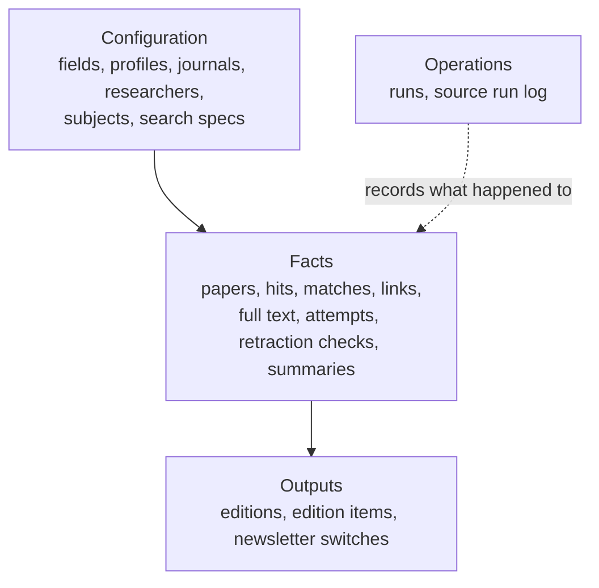
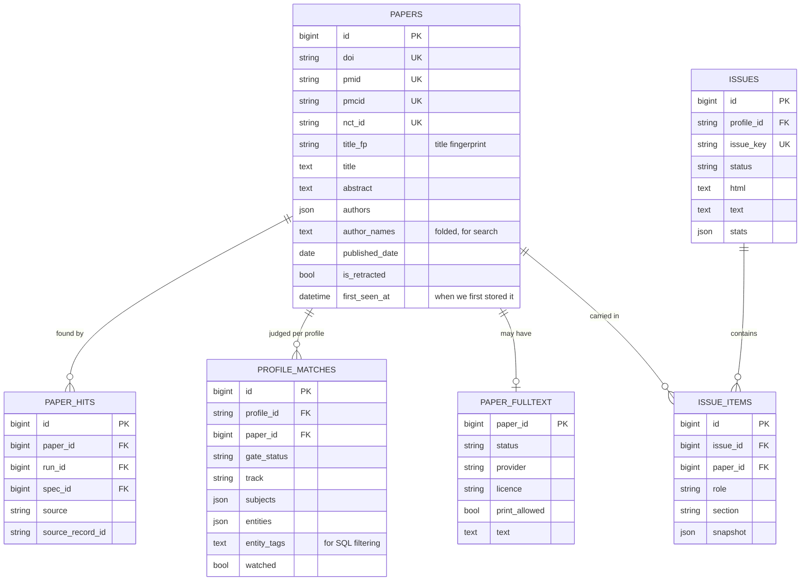

# 4. Data design

> **In short.** One PostgreSQL database (SQLite for local work and tests) holds 24 tables in four groups: **configuration**, **facts** about papers, **outputs** (frozen newsletter editions and the on/off switches) and **operations** (the run log). Business rules such as "one record per paper" and "a paper is never in two editions" are enforced by **unique constraints in the database**, not just by code. The schema evolves through additive migrations, and access is controlled by row level security and three roles.

## 4.1 Storage choices

| Choice | Why |
|---|---|
| **PostgreSQL** in production (Supabase) | relational integrity, JSON support, row level security and roles |
| **SQLite** for development and tests | tests run offline with no server; the same code path runs on both |
| **SQLAlchemy 2** and **Alembic** | one model definition, versioned migrations, a test that fails if the models and the migrations drift apart |
| **JSON columns** (`JSONB` on Postgres) | for shapes that are read whole and never filtered in SQL: author lists, subject matches, search parameters |
| **Derived text columns** | for anything that must be *filtered* in SQL on both databases (see 4.7) |

The portability rule: use only features both databases have. Where a feature is not portable (for example JSON containment), the design avoids it rather than branching on the database.

## 4.2 The four groups

## 4.3 The core model

## 4.4 Table catalogue

**Configuration** (loaded from YAML at the start of each run)

| Table | Purpose | Notable columns and constraints |
|---|---|---|
| `fields` | what a field means | `config` (JSON) and `config_hash` |
| `profiles` | one client's watch list | `config` (JSON), `active` |
| `journals`, `researchers`, `subjects`, `bridge_terms` | the watched items | unique per field on `key`, `code` or `term`; researchers carry ORCID, OpenAlex IDs and an `ambiguous` flag |
| `search_specs` | the concrete searches | unique `spec_key`; `path`, `source`, `params`, `meta`, `gated`, `active` |
| `profile_*` link tables | which journals, researchers, subjects and searches a profile uses | composite primary keys |

**Facts**

| Table | Purpose | Notable columns and constraints |
|---|---|---|
| `papers` | one row per distinct paper | each of `doi`, `pmid`, `pmcid` and `nct_id` is **unique**; `title_fp` indexed; `first_seen_at` indexed |
| `paper_hits` | every time a search found a paper | unique on `(paper, search, run, source record)` |
| `profile_matches` | what a paper means for a profile | unique on `(profile, paper)`; gate, language, track, subjects, entities, watched |
| `paper_links` | free links by kind | unique on `(paper, url)` |
| `paper_fulltext` | the stored text and its provenance | primary key is `paper_id`, so **at most one text per paper**; provider, tier, rights, licence, `print_allowed` |
| `fulltext_attempts` | each provider attempt and its outcome | indexed on `(paper, provider)` |
| `retraction_checks` | each source's retraction answer | many per paper |
| `paper_summaries` | cached model summaries | unique on `(paper, model, prompt version, abstract hash)` |

**Outputs**

| Table | Purpose | Notable columns and constraints |
|---|---|---|
| `issues` | one frozen edition | unique `(profile, issue_key)`; `status`, `html`, `text`, window, `stats`, `draft_ref` |
| `issue_items` | the papers in an edition | unique `(profile, paper, role)`; `snapshot` JSON freezes the decision |
| `newsletter_selections` | the on/off switches | primary key `(profile, kind, key)`; `enabled` |

**Operations**

| Table | Purpose |
|---|---|
| `runs` | one row per collection or full-text run: window, trigger, status, statistics |
| `source_run_log` | one row per search per run: records, new papers, requests, duration, error |

## 4.5 Constraints that carry business rules

| Rule | Enforced by |
|---|---|
| a paper exists once | each identifier column on `papers` is unique, plus a merge step that checks them all before inserting |
| a search's finding is recorded once | unique `(paper, search, run, source record)` on `paper_hits` |
| a paper has one judgement per profile | unique `(profile, paper)` on `profile_matches` |
| **a paper is never in two editions** | unique `(profile, paper, role)` on `issue_items` (`role` is `digest` or `retraction`, so a retraction alert about an already-sent paper is allowed once) |
| an edition key is unique per profile | unique `(profile, issue_key)` on `issues` |
| a summary is cached per input | unique `(paper, model, prompt version, abstract hash)` |
| a switch has one value | primary key `(profile, kind, key)` |

The point of putting these in the database: a bug in the application, a retry, or two overlapping runs cannot create a duplicate. The worst they can do is raise an error.

## 4.6 Indexes

| Index | Serves |
|---|---|
| `papers(first_seen_at)` | the newsletter's window query and "newest" sort |
| `papers(first_entry_date)` | source-date comparisons |
| `papers(content_type)` | hiding deposits, datasets and letters |
| `papers(title_fp)` | the title-fingerprint lookup during merge |
| `profile_matches(profile, gate_status)` | selecting relevant papers for a profile |
| `fulltext_attempts(paper, provider)` | deciding whether to retry a provider |
| `source_run_log(search, run)` | the silent-zero check against recent history |

At this volume (thousands of rows a year) these are enough; the primary keys and unique constraints cover everything else.

## 4.7 Derived columns for portable filtering

The search must filter by author, by researcher and by topic **in SQL**, on both databases, without JSON operators that differ between them. The design stores a small derived string next to the JSON:

| Derived column | Built from | Used for |
|---|---|---|
| `papers.author_names` | the authors, lower-cased, accents removed | author search: every word must appear |
| `profile_matches.entity_tags` | the matched journals and researchers as `|journal:key|researcher:key|` | filtering by a monitored journal or researcher by *identity* |
| topics | no column: the stored subjects JSON is matched as text (`"code": "2"`) | the topic filter |

The topic match works because both databases write the subject code the same way, and a quote inside another value would be escaped, so the pattern cannot match by accident. It also avoided a migration (see 4.12).

## 4.8 JSON columns

Used where the value is read whole and not filtered: `authors`, `issns`, `languages`, `pub_types`, `licences` and `retraction_sources` on a paper; `subjects` and `entities` on a match; `params` and `meta` on a search; `config` on fields and profiles; `stats` and `snapshot` on editions. On Postgres they are `JSONB`.

## 4.9 Time

* All timestamps are UTC and timezone-aware.
* **`first_seen_at` is the clock that drives the newsletter**: the moment our database first stored the paper. It is set once and never changed. Selecting by it, not by publication date, means a paper that appears late in an index still reaches an edition once.
* `published_date` may be missing (some sources give only a month or year); `published_label` keeps what the source said, and freshness uses the latest possible date.
* An edition's window is stored as a start and end timestamp.

## 4.10 Full text

`paper_fulltext` has one row per paper (its primary key is the paper's id). It stores the status, the format (XML, PDF text or plain text), the provider and tier, the rights class, the licence, whether printing is allowed, a word count and the text itself. Attempts are kept separately in `fulltext_attempts`, so the reason a paper has no text is always on record. In a test sample, 67 stored texts totalled 3 MB (about 45 KB each, the largest about 96 KB). At today's rate that is an estimated 100 to 200 MB of text a year, which is worth checking against a hosted plan's storage limit.

## 4.11 Frozen editions

An edition is stored whole: the final HTML and text, the window, statistics and notes, and for each paper a **snapshot** of what was decided (title, journal, summary, score, group, full-text status, whether it was carried over). This means:

* what was sent can be shown exactly as sent, even if the paper's data changes later;
* a published edition is never rebuilt, so the Gmail draft and the stored copy always match;
* the Editions tab is a plain read of two tables.

## 4.12 Migrations

Ten Alembic revisions so far, all additive:

| Revision | Adds |
|---|---|
| 0001 | the initial schema |
| 0002 | `papers.content_type` |
| 0003 | full-text provenance and the attempts table |
| 0004 | `paper_fulltext.refreshed_at` |
| 0005 | `papers.pmcid_found_at` |
| 0006 | newsletter editions and the published label |
| 0007 | cached summaries |
| 0008 | `papers.abstract_source` |
| 0009 | `profile_matches.watched` |
| 0010 | the switches table and the derived search columns, with a backfill |

**Policy.** Each job runs `db upgrade` first, so a pushed migration is applied by the next run. A test applies the migrations to an empty database, compares them with the models, and checks they round-trip.

**Lesson that shaped the design.** The ORM selects every column of a table. If a deployment adds a column before its migration has run, the live API's queries fail until a job applies it, because the API's read-only role cannot migrate. So a feature that can avoid a new column on an existing table should (the topic filter does), and a column that is needed is added in a migration that runs before the code that reads it.

## 4.13 Security in the database

* **Row level security** is enabled on every table by the migrations. A role with no policy sees nothing.
* **Three roles:** the *owner* (the jobs), a *read-only* role for the API's data routes, and a *switches-only* role that can read and write only `newsletter_selections`. The read-only role reads ten tables: papers, matches, full text, summaries, links, hits, editions, edition items, runs and the switches.
* **No elevated rights:** the roles are created with no superuser and no row-security bypass, and the setup command verifies that afterwards.
* **Read-only enforcement is two-layered.** The role's own default is read-only sessions, and every transaction on the API's data connection starts with `SET TRANSACTION READ ONLY`, which also holds behind a transaction pooler where session settings do not stick.
* Passwords are random, written straight into the git-ignored `.env`, and never printed.

## 4.14 Connections and transactions

* **One unit of work per `session_scope`:** commit on success, roll back on any error.
* **Commit per search** during collection, so progress is kept if a run is stopped part-way.
* **Pooling.** Normal connections use `pool_pre_ping`. Behind a *transaction-mode* pooler the code uses no application pool (the pooler is the pool) and disables server-side prepared statements, which that mode cannot keep.
* **Foreign keys** are switched on explicitly for SQLite, which ignores them otherwise.

## 4.15 Growth and retention

At about 20 new papers a day the database grows by roughly 7,000 papers a year, plus matches, hits and the stored text. Nothing is deleted automatically; the data is small enough that retention can be decided later. Editions are small (tens of kilobytes each).

**Next:** [5. Reliability, security and operations](05-reliability-security-operations.md).
