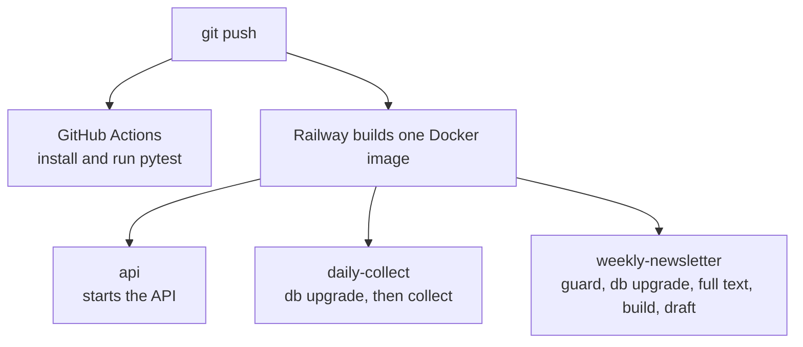

# 5. Reliability, security and operations

> **In short.** The system is built so that **failure is boring**: every step can be re-run safely, one broken part rarely ruins a run, and what failed is recorded where an operator can see it. Security follows least privilege: the public API cannot change papers, the program cannot send email, and secrets never reach logs. This chapter lists the failure modes and how each is handled, the threats and their mitigations, how it is built and deployed, and how it is tested.

## 5.1 Failure modes

| Failure | How it is noticed | Effect | Recovery |
|---|---|---|---|
| one source API is down or slow | that search records an error; the run is `partial` | the other sources continue | automatic: each run looks back three days |
| a source quietly changes and returns nothing | `suspect_zero` (a search that normally returns results returned none) | run is `partial` | investigate the adapter |
| an adapter has a bug | caught per search and recorded as `adapter crashed` | other sources continue | fix and re-run |
| the daily job fails | exits non-zero; the host shows it failed | no new papers that day | re-run; the next run also looks back three days |
| the weekly job starts without a fresh collection | the 12-hour freshness guard | the job fails instead of building from stale data | fix, run the daily job, run the weekly job |
| a job hangs | a hard `SIGALRM` timeout (45 minutes daily, 150 weekly) | exits non-zero | re-run |
| a job crashes mid-run | a run left "running" is closed as failed after three hours | progress committed so far is kept | re-run: every step is idempotent |
| a full-text route fails | the attempt and its outcome are recorded | the paper stays abstract-only and is retried after a retry window | none |
| the summary model fails or invents a number | the validation check fails | that paper gets an abstract extract instead | none |
| the edition is too large for Gmail | the size cap | the lowest-ranked papers are held back | none |
| the Gmail step fails (for example an expired token) | the edition stays `built`; the app says "draft not created yet" | no draft yet | fix credentials, run `newsletter publish <key> --to gmail` |
| the database is unreachable | the job exits non-zero | nothing is written | re-run when it is back |
| two runs overlap | the scheduler skips a run while the previous one is still going; unique constraints guard the data | none | none |
| a setting is invalid | validated when the config loads | the job fails immediately and says why | correct the YAML |

## 5.2 Idempotency: where re-running is safe

| Operation | Why a repeat is harmless |
|---|---|
| collection | papers merge by identifier; a repeat finds the same papers and adds no rows; hits are unique per run |
| full text | attempts are recorded, so a provider that failed is not asked again within its retry window; a stored text is not fetched again |
| building an edition | an existing built edition is returned unchanged unless `--rebuild` is given; a published or sent edition is never rebuilt |
| creating a draft | the stored draft id is reused while that draft exists |
| on/off switches | `PUT` and `DELETE` set a value; setting it again changes nothing |
| migrations | applied at the start of every job; an up-to-date database is a no-op |

## 5.3 Timeouts, retries and guards

| Mechanism | Setting |
|---|---|
| HTTP timeout per request | 60 seconds |
| HTTP retries | up to 4 tries on 429/5xx with exponential back-off capped at 60 s, or `Retry-After` |
| per-host pacing | a minimum interval between requests, per source |
| job timeouts | 45 minutes (daily), 150 minutes (weekly) |
| weekly freshness guard | a successful collection within the last 12 hours |
| collection look-back | 3 days (`JOB_OVERLAP_DAYS`) |
| full-text batch | `JOB_FULLTEXT_LIMIT` papers per run |
| API limits | 120 requests per minute per client, 10 wrong tokens per minute, page size at most 200 |

## 5.4 Observability

The database is the log, so the answer to "what happened?" is a query away.

| Question | Where to look |
|---|---|
| did the collection run, and how did it go? | `runs`: window, trigger, status (`ok`, `partial`, `failed`) and a statistics block (searches, records, rejected by the gate, new papers, errors, per-source counts, enrichment, duration) |
| which search failed, and why? | `source_run_log`: one row per search with records, new papers, requests, duration and error |
| is a search silently broken? | the `suspect_zero` status |
| what happened to this edition? | `issues.stats`: counts per section, what was held back or left out and why, summary counts, notes |
| from the command line | `research-agent status` |
| from the API or web app | `GET /v1/runs`, `GET /v1/stats`, the Editions tab |
| what did a job do, step by step? | the host's log: each step is logged with a time |

## 5.5 Threat model

| Threat | Mitigation |
|---|---|
| guessing a token | random tokens; constant-time comparison; lockout on repeated wrong tokens; a per-client rate limit |
| a leaked read token | it can only read; rotate it by changing the environment variable |
| a leaked admin token | it can only flip newsletter switches, and the connection behind it can write only one table |
| hostile text in a paper title or abstract (script injection) | the web app builds elements from text, never HTML strings; a strict content security policy (no inline script, same-origin connections, no framing); the edition preview sits in a sandboxed frame with scripts disabled; templates autoescape |
| SQL injection | queries are parameterised by the ORM; the keyword patterns escape `%`, `_` and `\` |
| cross-site request forgery | the API uses a bearer header, not cookies |
| secrets in errors or logs | the HTTP client scrubs keys from every error message; secrets live only in the environment |
| the program emailing someone by mistake | it only creates drafts; a person sends |
| API abuse or overload | rate limits, a page-size cap, read-only access (the limiter is per process; see 5.9) |
| tampering with data through the API | there is no write route except the switches |
| a compromised API process reaching the database | the API holds only the read-only and switches-only roles, never the owner's credentials; row level security is on |

One honest note: the full-text PDF route follows links supplied by scholarly indexes and does not forward credentials. That is acceptable because the inputs are trusted indexes. If the service ever accepted links from untrusted users, that route would need stricter destination checks.

## 5.6 Configuration and secrets

* **Environment variables** carry every secret and hosting setting (the twelve-factor way). They are never baked into the image and the `.env` file is git-ignored.
* **Everything optional.** A credential that is present switches on its route; absent, that route is simply off.
* **Roles are generated**, not typed: a command creates the limited database roles with random passwords and writes the connection strings straight into the environment file without printing them.

## 5.7 Build, CI and deployment

* **One image** for all three services. It is based on a slim Python image, installs `poppler-utils` (for reading free PDFs), installs the package, and runs as a non-root user. The default command is the API; the two cron services override the start command.
* **CI** runs the test suite on every push and pull request. It deploys nothing.
* **Cron semantics** (the host's rules): schedules are UTC and at least five minutes apart; the start time can drift by a few minutes; a run still going when the next is due makes the host skip that one; the host never stops a hung run, which is why each job stops itself.
* **Migrations** run at the start of each job.

## 5.8 Testing strategy

| Layer | How it is tested |
|---|---|
| domain rules (gate, identity, ranking, caps, freshness, summary checks, text repair) | pure functions: plain unit tests |
| repository and pipeline | integration tests on an in-memory SQLite database |
| source adapters and parsers | **recorded real API responses** in `tests/fixtures`, replayed through an injected HTTP transport |
| API | the framework's test client: tokens, limits, filters, sorting, errors, the settings routes, the served page and its security headers |
| newsletter | build and render tests: ordering, caps, carry-over, layout, the At a glance panel, the draft publisher |
| migrations | applied to an empty database, compared with the models, and round-tripped |
| jobs | step order, stop on first failure, timeouts, the weekly guard |
| live | a small marked set that hits the real services (`pytest -m live`) |

**Determinism by injection.** Clocks, sleeps and HTTP transports are parameters (the HTTP client, the rate limiter, the ingest pipeline, the newsletter service and the API limiter all accept them), so tests of time, back-off and throttling run instantly with no real waiting. The default suite needs no network and no credentials.

## 5.9 Cost and scaling notes

**Cost control.** Model calls are paced, capped per run, and cached by input, so a rebuild costs nothing. The metered source has a credit guard that stops before the allowance runs out. No paid subscription is needed; compute is one small always-on service plus two short cron jobs.

**What would change at ten times the load** (not needed today):

| Pressure | Change |
|---|---|
| several API workers | move the rate limiter out of process (a gateway or shared store) |
| deep result paging | keyset paging instead of offset |
| searching text at scale | a database text-search index, then perhaps vectors (planned for v2.0) |
| many full-text fetches | a work queue with workers instead of one sequential pass |
| heavy read traffic | a read replica for the API's connection |

**Next:** [6. Decision log](06-decision-log.md).
