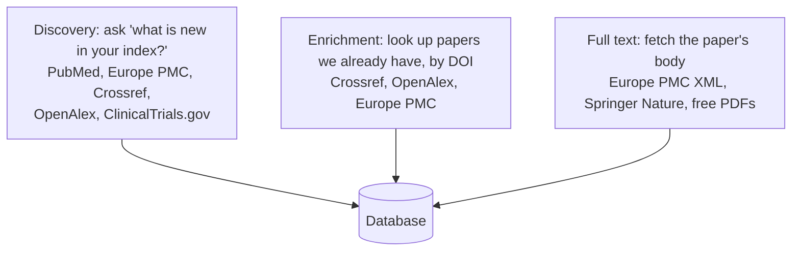
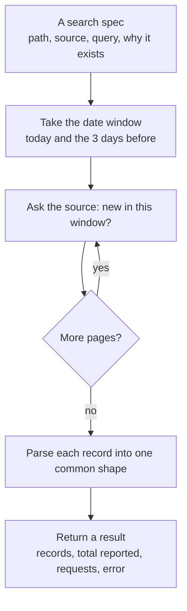
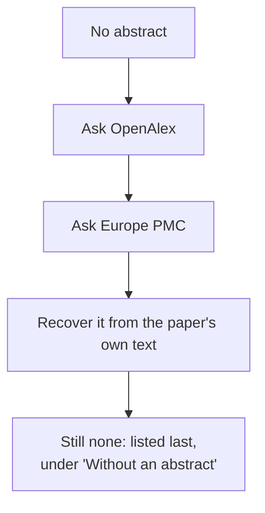
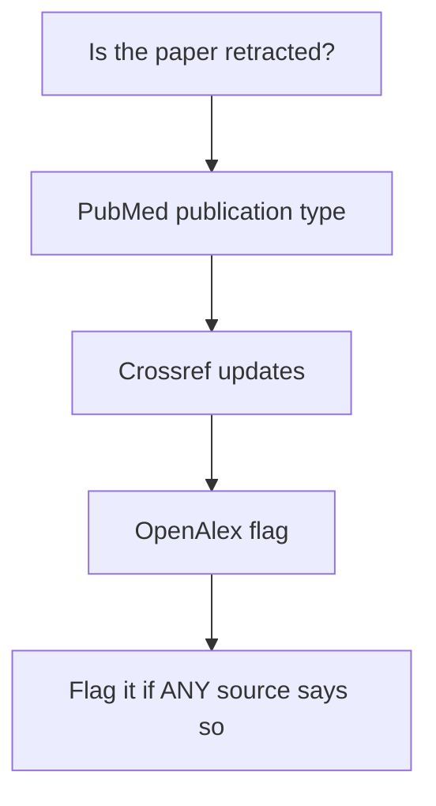
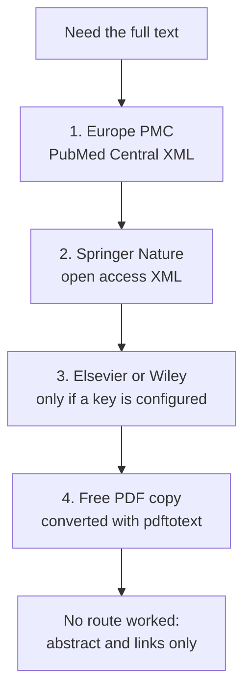

# 7. Data sources and ingestion

> **In short.** The system gets its papers from **five independent indexes** because no single one is complete: in a measured window each source found only 27 to 53 percent of the distinct new papers. Every source is asked the same way: *"what entered your index in this date window?"*, never *"what was published in it?"*, because publication dates turned out to be unreliable. Results are normalised, checked against a relevance gate, merged by identifier, and then enriched from other sources. When a source or a step fails, a documented fallback takes over. This chapter lists what each source gives, how it is queried, the fallbacks, and what we observed while building and testing the pipeline.

Evidence in this chapter comes from two places: the live checks recorded in `Discovery_API_check.md`, `Window_filter_tests.md`, `Journal_source_validation.md` and `Researchers_source_validation.md` (run 30 and 31 October 2026), and the behaviour of the code itself. Numbers are from small samples (one topic, a few days) and are meant to explain design choices, not to be quoted as long-run rates.

## 7.1 The sources at a glance

| Source | What it gives us | How we ask | Date used | Paging | Pace |
|---|---|---|---|---|---|
| **PubMed** (NCBI E-utilities) | the core biomedical record: title, abstract, authors (with ORCID when present), ISSNs, publication types (which carry the retraction flags), PMID, DOI, PubMed Central ID; also book chapters | `esearch` to list IDs, then `efetch` XML in batches of 150 | **entry date** (`edat`) | one `esearch` (up to 10,000 IDs), then batches | 3 requests/s, 10/s with the free key |
| **Europe PMC** | broad literature and **preprints** (`SRC:PPR`), abstracts, language, PubMed Central ID; later also full text | REST search, query `TITLE_ABS:` plus the gate word | **first index date** (`FIRST_IDATE`) | cursor, 1,000 per page | about 6 requests/s (0.15 s apart) |
| **Crossref** | publisher-deposited metadata: DOIs, licences, text-mining links, retraction updates; reaches papers PubMed never indexes | `/works`, and `/journals/{issn}/works` per ISSN | **created date** | cursor, 1,000 per page | 1 request/s in the public pool (0.25 s with a Plus token) |
| **OpenAlex** | an open scholarly graph: titles, abstracts (rebuilt from an inverted index), retraction flag, open-access locations, confirmed author IDs | `/works` with `title_and_abstract.search`, or `author.id` for a researcher | **publication date over a 14-day look-back** on the free plan; created date on a premium plan | cursor, 200 per page | 0.12 s apart, plus a daily credit budget |
| **ClinicalTrials.gov** | registered trials (not peer-reviewed publications) | API v2, `query.term` with a first-posted-date filter | **study first post date** | token, 100 per page | 0.2 s apart |

Every request also goes through the shared HTTP client (see [chapter 2](02-low-level-design.md#24-source-adapters-and-the-http-client)): per-host pacing, retries with back-off, and key scrubbing.

## 7.2 How one retrieval works

Every source follows the same contract, so the pipeline treats them alike:

* **A spec says why a search exists.** A topic search is for the field's word; a journal search carries the journal's key and ISSNs; a researcher search carries the person's key and the confidence of the match. That metadata travels with every paper it finds.
* **Paging is cursor-based** wherever the source offers it, with a safety stop (20,000 records for Europe PMC and Crossref, 5,000 for OpenAlex) far above a daily window.
* **One common record shape.** Identifiers are normalised (a DOI is lower-cased and stripped of its `https://doi.org/` prefix; a month-only date is *not* turned into an exact day), journal names have HTML entities removed, and OpenAlex abstracts are rebuilt from their word-position index.
* **A source never raises into the pipeline.** Failures come back as a result with an error; a crash inside an adapter is caught and recorded, and the other sources continue.

## 7.3 Time: why "entry date", never "publication date"

The most important design finding came from measuring the date filters (4-day window, 30 October 2026):

| Source and filter | Finds | Verdict |
|---|---|---|
| PubMed entry date (`edat`) | 43 papers, exactly those entered in the window | **use** |
| PubMed publication date (`pdat`) | 16 of the same 43 (37%) | do not use: month-only dates drop out and most papers are indexed days after publication |
| Europe PMC first index date | 55 papers, exact | **use** |
| Europe PMC first publication date | 18 of 55 (33%) | do not use |
| Crossref created date | 59 papers, exact | **use** |
| Crossref index date | about 1,000, 18 times the created count | do not use: it returns re-indexed records |
| OpenAlex created date | refused on the free key (HTTP 429, plan upgrade needed) | not available free; use a publication-date look-back and de-duplicate |
| ClinicalTrials.gov first post date | 5 trials, exact | **use** |
| ClinicalTrials.gov first *submit* date | 0 in every window, with no error | **silent zero**: avoid it and keep an alarm for it |

Why publication dates fail, measured in PubMed: of 162 recently entered papers with an exact publication date, 49 percent entered the index more than 3 days after it and 38 percent more than 14 days after; another 39 percent have only a month or a year. In Europe PMC the median gap was 15 days. A weekly search by publication date found only 39 percent (29 of 74) of what PubMed had actually added that week.

**Consequences in the design**

* The daily job looks back **three days**, so one skipped run loses nothing.
* OpenAlex is treated as a supplement: on the free plan it looks back 14 days by *publication* date and relies on de-duplication.
* **Late arrivals** were checked by re-running the same queries a day later: for the seven earlier days, 0 of 289 records appeared that had not been there before, so back-dated records did not occur in that check (one night, three sources; a real risk but small on this evidence).

## 7.4 Why several sources: what each adds

In a 4-day window the union held 111 distinct papers, and **no source found more than 53 percent** of them:

| Source | Share of the 111 it found |
|---|---|
| PubMed | 39% |
| Europe PMC | 50% |
| Crossref | 53% |
| OpenAlex (publication-date) | 27% |
| found by all four | only 9 papers |

The first full run into an empty database stored 233 papers: **158 came from a single source** (129 of them from OpenAlex), 51 from two, 12 from three and 12 from all four. Notable gaps:

* **Crossref-only papers are real.** Of 37 papers only Crossref found, 34 are not in PubMed at all. They include headache-specific journals (such as *Headache and Pain Research* and *Headache Medicine*) alongside low-profile titles, which is why a quality screen for Crossref-only journals is still an open question.
* **Europe PMC-only papers are mostly old PubMed records** that Europe PMC indexed for the first time in the window; de-duplication by DOI removes them.
* **The topic search finds almost everything PubMed can.** The journal and researcher searches added nothing new on PubMed, as predicted; they stay because they say *why* a paper matters (a monitored journal or researcher) and cover indexing gaps.

## 7.5 Three search paths

| Path | Purpose | Observation |
|---|---|---|
| **topic** | the field's gate word across every index | does most of the finding |
| **journal** | one PubMed query per journal, one Crossref query **per ISSN** (print and online are indexed separately) | confirms and labels; two online ISSNs (Lancet Neurology, JAMA Neurology) are unknown to Crossref and are skipped, not treated as errors |
| **researcher** | PubMed by `Surname Initials`, OpenAlex by confirmed ID | the spreadsheet's own PubMed links returned **0 results for all 30 researchers**; all 30 were re-resolved to ORCID and OpenAlex IDs; three names (Wang SJ, Charles A, Hoffmann J) stay ambiguous in PubMed and never decide anything alone |

Two further paths exist for completeness: **preprints** (Europe PMC `SRC:PPR`) and **trials** (ClinicalTrials.gov), plus an approved-list **bridge** path for mechanism papers that is empty until a list is approved.

## 7.6 The gate and the noise

A record must mention the field's word in its title or abstract (the gate, [chapter 2](02-low-level-design.md#27-the-relevance-gate-language-and-track)). Other filters are applied **after** retrieval, deliberately:

* **English only, checked on the record**, not in the query: Europe PMC's `LANG:eng` silently drops records whose language field is empty (about 5 percent), so those are kept as "unknown".
* **Content types.** OpenAlex returns many repository deposits (in the sample: Zenodo 21, Open Science Framework 7, Figshare 4), datasets and book chapters. They are stored and flagged but kept out of newsletters by default.
* **Noise types** such as errata and letters are classified and hidden from digests, but retraction state is evaluated first so a retraction is never hidden.

## 7.7 Enrichment, and the fallback ladders

After merging, three batched lookups fill what a source did not provide. Each is a **ladder**: if the first rung does not help, the next is tried.

* **Retractions are split across sources, so we use the union.** Of 18 retracted migraine papers that PubMed flags, Crossref flagged 10, OpenAlex 12 and Europe PMC 12; together they still missed 6. In the other direction PubMed misses real ones that Crossref records. In a later live run over 19 papers, PubMed and OpenAlex each flagged all 19 and Crossref 16.
* **Notices are separate records.** A retraction notice appears as its own record; it is attached to its original and never listed as a normal paper. Papers sent in the last weeks are re-checked before each build.
* **PubMed Central ID.** A PMC ID unlocks the cleanest full-text route, so papers without one are looked up in Europe PMC; PMC can lag publication by weeks, so recent papers are re-checked on later passes.

## 7.8 Full text

| Route | What it gives | Observed |
|---|---|---|
| Europe PMC full-text XML | structured JATS text with the licence inside | the cleanest source; about 110 to 140 KB per paper |
| Springer Nature open access API | JATS text and licence for open Springer, BMC and Nature papers | returned text for 14 of 28 sampled papers; the rest are not open access |
| Elsevier, Wiley | text for papers the key is entitled to | built but **inactive**: no keys requested (owner decision); Wiley refused all 14 scripted PDF attempts in a test |
| Free PDF (found by OpenAlex or Europe PMC) | raw text via `pdftotext` | works for some publishers (13 of 30 downloaded in a test); reading order and tables are only as good as the PDF |

Coverage measured on a month of migraine records: 66 percent open access in Europe PMC; with OpenAlex and Unpaywall about **86 percent have some free copy** somewhere and about 12 percent look closed. Being free to read is not the same as being fetchable by a script, which is why every attempt is recorded and a failed route is not retried for a week. Each stored PDF is re-checked to be the right paper, and a wrong one is removed.

## 7.9 The fallback matrix

| If this is missing or fails | What happens instead |
|---|---|
| a source API is down or errors | the run is marked partial; other sources continue; the 3-day look-back catches the papers on later runs |
| a search that usually returns results returns none | recorded as a **suspect zero** so someone looks at it |
| OpenAlex's created-date filter is refused (plan) | it switches itself to the publication-date look-back for the rest of the run and says so in the run log |
| OpenAlex credits run low or a request cap is hit | OpenAlex searches stop with a clear note; the others are unaffected |
| Crossref has no record for an ISSN (404) | the search is skipped, not counted as an error |
| a record has no abstract | other sources are asked; then the text is searched; then it is listed last |
| Google Scholar | **not used**: no API, and scraping is against its terms and gets blocked (the earlier newsletter agent used Scholar alert emails; that route is not part of this system) |
| Cochrane Library | **blocked** (a bot challenge); PubMed's Cochrane items stand in for it (113 migraine mentions all-time, about 2 a year) |
| bioRxiv and medRxiv APIs | not used for discovery: they have no topic filter, so finding one migraine paper took 65 or more requests and several minutes; Europe PMC `SRC:PPR` answered in one request |
| publisher RSS feeds | not used: 8 of 11 tried worked, but ISSN-based queries cover the same journals reliably, and 8 of 10 journal homepages block scripts (HTTP 403) |
| no free full text | the paper is shown with its abstract and links, and labelled as such |

## 7.10 What we observed while building it

1. **No source is complete,** and the gaps differ (7.4). The union is the design.
2. **Publication dates are unreliable discovery keys** (7.3); entry and index dates are exact apart from a one-day edge effect in PubMed's entry date (16 extra records in one window, absorbed by the look-back).
3. **Silent zeros exist.** A ClinicalTrials.gov date field returned nothing without any error, which is why a normally-busy search that returns nothing is flagged.
4. **Small API details break whole searches.** PubMed's `esearch` always returns an `errorlist` object; treating its mere presence as an error broke every journal search on the first run. Only a non-empty `fieldsnotfound` is a real error.
5. **Crossref surprises.** `from-index-date` returns metadata updates, not new papers; two online ISSNs return 404; a retracted article's own record can list a retraction that points at itself and must not be read as a notice; one real PubMed retraction notice is typed as an erratum, so machine-readable types are not enough and a conservative title check is used as an extra signal.
6. **OpenAlex is metered.** Without a key a shared daily budget of $0.10 applies; a free key gives about 10,000 credits a day (roughly 1,000 simple requests), reported in a response header, which the adapter reads to stop before running out. Its free key has no created-date filter.
7. **Repository deposits and book chapters are common in OpenAlex results,** so content types are classified and kept out of digests.
8. **Language fields are incomplete,** so English is judged after retrieval and "unknown" is kept.
9. **Retractions are split across sources** (7.7), so the rule is the union; no one source is trusted alone.
10. **Preprints are easiest through Europe PMC.** Of 28 sampled migraine preprints, all had abstracts; they came from several servers (Research Square, medRxiv, Preprints.org, bioRxiv, PsyArXiv), most of them not the ones the client had listed, and the extra servers were included, labelled not peer reviewed.
11. **Publisher sites block scripts,** so article data comes from the indexes by ISSN, not from journal pages.
12. **Researcher names are weak identifiers.** The client's PubMed links returned nothing; identity comes from confirmed ORCID and OpenAlex IDs, with ambiguous names demoted.
13. **Volume is modest.** The first run stored 233 papers; replaying five consecutive days stored 229, then 27, 23, 19 and 18, so steady state is roughly **20 new papers a day** across all sources, and a repeat of the same window adds nothing.
14. **Round trips dominate run time.** The first production collection took about 23 minutes because thousands of tiny database statements each paid a transatlantic round trip inside one transaction. Batching lookups, committing per search and moving the service next to the database brought a daily run to about two minutes.
15. **About half of recent papers end up with full text.** In the first production edition 17 of 34 papers carried full text, and the first production full-text pass stored text for 63 of 156 papers it tried.

## 7.11 Known limits and what is unverified

* The numeric rate limits for Europe PMC and ClinicalTrials.gov were not found; the adapters pace themselves conservatively.
* Crossref Plus and OpenAlex premium behaviour are built but untested because no such keys exist.
* Publisher terms of use were not reviewed; the owner decided licences do not limit printing.
* All measurements are from one topic over a few days: they justify design choices but are not long-run rates.
* A quality screen for papers that only Crossref or OpenAlex index is still an open question.

**Adding a source** is described in [chapter 2](02-low-level-design.md#218-extending-the-system): one adapter, its searches in the planner, a registry entry and recorded-response tests.
